# CAAO for opencode

**Capability-Oriented Adaptive Orchestration** — a complete, working implementation on top of
[opencode](https://opencode.ai) 1.18.x.

The system does not orchestrate *agents*. It orchestrates **capabilities**, selected by **declarative
policies** from a **semantic** reading of the request, bound to **providers** resolved independently and
escalated by **confidence**, executed as a **dynamic DAG** by a swarm of disposable workers, merged back
under confidence-driven validation, and reported with **full model attribution**.

```mermaid
flowchart LR
  dev([Developer request]) --> em[Execution Manager]
  em --> tri["Semantic triage<br/>intent + confidence"]
  tri --> cls["Classification<br/>keywords ⊕ semantics, fused by band"]
  cls --> pol[Policy engine]
  pol --> caps[Capability set]
  caps --> prv["Provider resolution<br/>+ conditional escalation"]
  prv --> wf[Workflow strategy]
  wf --> dag[Execution DAG]
  dag --> swarm[Disposable workers]
  swarm --> merge[Merge + validation gates]
  merge --> rep["Attribution recap<br/>who did what, with which model"]
  rep --> ans([Unified answer])
  merge -. blocking finding .-> dag
```



**Three properties worth knowing up front:**

1. **The request is understood, not pattern-matched.** A triage pass reads the request semantically and
   reports how sure it is. Keyword rules survive only as a deterministic fallback.
2. **Uncertainty buys horsepower.** Confidence bands declared in `policies.yaml` decide when to raise the
   complexity, add planning and review, and route the work to a heavy model — and you can declare as
   many heavy models as you like.
3. **Every run explains itself.** `caao_report` shows *plan by Opus, code by Kimi, review by Opus*, with
   attempts, confidence, timing, and the verbatim reason for every escalation.

---

## Quick start

```powershell
# 1. dependencies (once)
cd .opencode; npm install; cd ..

# 2. generate the agent definitions from the YAML registries
npm run caao:sync

# 3. wire the company catalog into opencode.json (MCP servers, skills)
npm run caao:catalog

# 4. run
opencode                      # the CAAO Execution Manager is the default agent
opencode run --agent caao --auto "Implement OAuth 2.0 with Google and GitHub"
```

Company rollout — two servers, two audiences ([docs/07](docs/07-distribution.md)):

```powershell
# 4a. every developer: signed configuration only, no run data, no console
npm run caao:keygen                            # once, platform team
$env:CAAO_SIGNING_KEY = "C:\caao-keys\caao-signing.key"
npm run caao:dist                              # serves /dist/* company-wide

# on a developer machine — .opencode/distribution.json points at that server
npm run caao:update                            # fetch, verify, apply, regenerate agents
                                               # (also runs automatically at every startup)

# 4b. admins only: the console. Refuses to start without a token.
$env:CAAO_ADMIN_TOKEN = "…"
npm run caao:dashboard                         # http://127.0.0.1:20129
```

Verify the wiring at any time:

```powershell
opencode debug config              # providers + all 32 agents
opencode debug agent caao          # Execution Manager: orchestration tools, no write access
opencode debug agent caao-security # worker: read-only, no orchestration tools, no task tool
npm run caao:doctor                # can every declared MCP and context tool actually start?
npm test                           # 163 unit tests, no LLM required
npm run test:e2e                   # full loop against a mock provider
npm run test:dashboard             # console auth, dist isolation, signed bundle round trip
npm run test:all                   # all three
node tests/integration/examples.mjs # see how any change to the YAML affects real requests
```

---

## What is in the box

| Path | Role |
| --- | --- |
| [.opencode/capabilities.yaml](.opencode/capabilities.yaml) | **WHAT** the system can do — 15 capabilities. No models, ever. |
| [.opencode/providers.yaml](.opencode/providers.yaml) | **WHO** executes a capability — pools, tiers, traits, profiles, conditional escalation, fallback chains. |
| [.opencode/policies.yaml](.opencode/policies.yaml) | **WHEN** a capability is required — classification, confidence bands, base/augment/post policies. |
| [.opencode/workflows.yaml](.opencode/workflows.yaml) | **HOW** a capability set is executed — strategies, retries, gates, merge. |
| [.opencode/catalog.yaml](.opencode/catalog.yaml) | **WHAT EVERY DEVELOPER GETS** — central MCP, skills and context infrastructure, scoped by repository or team. |
| [.opencode/distribution.json](.opencode/distribution.json) | **WHERE CONFIGURATION COMES FROM** — the one bootstrap file shipped by hand; everything else updates itself. |
| [.opencode/caao/](.opencode/caao) | Pure, deterministic orchestration engine (no LLM, fully unit-tested). |
| [.opencode/plugin/caao.js](.opencode/plugin/caao.js) | opencode adapter — exposes the engine as 12 `caao_*` tools, and meters every model call and context-tool saving opencode reports. |
| [dashboard/](dashboard) | **Admin-only** console — runs, live DAG, costs, tokens, savings, repositories, models, catalog. No framework, no build step. Deliberately outside `.opencode/`, so a developer's machine only receives the configuration. |
| [.opencode/agent/](.opencode/agent) | **Generated** agent definitions, one per capability × pool (`npm run caao:sync`). |
| [.opencode/prompts/execution-manager.md](.opencode/prompts/execution-manager.md) | Execution Manager doctrine. |
| [tests/](tests) | 163 unit tests + a mock-provider end-to-end test + a console/distribution API test. |

---

## Documentation

| Document | Contents |
| --- | --- |
| [docs/01-architecture.md](docs/01-architecture.md) | The full model, every diagram, the runtime loop, retries, gates, merge, attribution. |
| [docs/02-configuration.md](docs/02-configuration.md) | Field-by-field reference for the four YAML registries, confidence bands and overrides. |
| [docs/03-tools.md](docs/03-tools.md) | The 12 orchestration tools with argument tables. |
| [docs/04-examples.md](docs/04-examples.md) | Nine worked scenarios with real, generated output — including the same request understood two ways, and proof of concurrent execution. |
| [docs/05-operations.md](docs/05-operations.md) | Extending, adding heavy models, tuning the bands, widening the graph, testing, troubleshooting. |
| [docs/06-dashboard.md](docs/06-dashboard.md) | The enterprise console: cost model, budgets, live DAG, run rationale, repository segmentation, central MCP/skill distribution, security posture. |
| [docs/07-distribution.md](docs/07-distribution.md) | Keeping every developer up to date: signed bundles, content-addressed versions, channels and staged rollout, startup auto-update, and why developers cannot open the console. |
| [docs/08-mappa-dei-file.md](docs/08-mappa-dei-file.md) | In italiano: cosa fa ogni file del progetto, più un esempio concreto di una richiesta dall'inizio alla dashboard. |
| [docs/09-customizzazione.md](docs/09-customizzazione.md) | Guida pratica in italiano per aggiungere nuovi agent, cambiare il routing per difficoltà e rendere il sistema completamente personalizzabile. |

---

## The recap

Every answer ends with this, produced by `caao_report`:

| Phase | Capability | Model | Attempts | Confidence | Time | Cost |
| --- | --- | --- | --- | --- | --- | --- |
| plan | Planning | `omniroute/github/claude-opus-5` | 1 | 0.94 | 2ms | $2.12 |
| build | Implementation | `omniroute/github/kimi-k2.7-code` | 1 | 0.86 | 2ms | $0.07 |
| verify | Testing | `omniroute/github/kimi-k2.7-code` | 1 | 0.91 | 2ms | $0.05 |
| validate | Code Review | `omniroute/github/claude-opus-5` | 1 | 0.90 | 2ms | $1.31 |
| validate | Security Review | `omniroute/github/claude-opus-5` | 1 | 0.93 | 4ms | $1.44 |

Rows marked `⬆` were escalated, and the recap states the reason declared in `providers.yaml`.
The cost column comes from the per-pool `pricing` block — the router never reads it, it only bills with it.

The recap also reports how wide the run was:

```
parallelism  : 3 waves, widest 3 concurrent (1 -> 1 -> 3), budget 8
```

Five nodes, three waves. Testing and the two reviews all read the same build output and none reads the
others', so they were dispatched in a single turn and executed simultaneously. Which phases wait for
which is declared in `execution.phase_depends_on`, not hardcoded — remove a dependency and the graph
gets wider, add one and it gets stricter.

---

## The one rule

> A capability never knows which model runs it.
> A policy never names a model.
> A worker never knows another worker exists.
> How much is spent is a function of how well the request was understood — and that function is a
> configuration file, not code.

Everything else follows from that.

## Company context infrastructure

The admin console manages three independently switchable context layers:

- **Caveman** for terse replies and bounded, recoverable tool output;
- **Headroom** for on-demand compression, original retrieval and savings telemetry;
- **Graphify** for a persistent, queryable repository knowledge graph.

They are signed catalog presets, not hidden executables. A verified update projects enabled MCP definitions into each developer's `opencode.json` while preserving developer-owned MCP entries. Admins can add MCP servers, skills and context tools from the dashboard; credentials must remain `{env:NAME}` references. The platform bootstrap remains responsible for installing the declared commands on developer machines.
