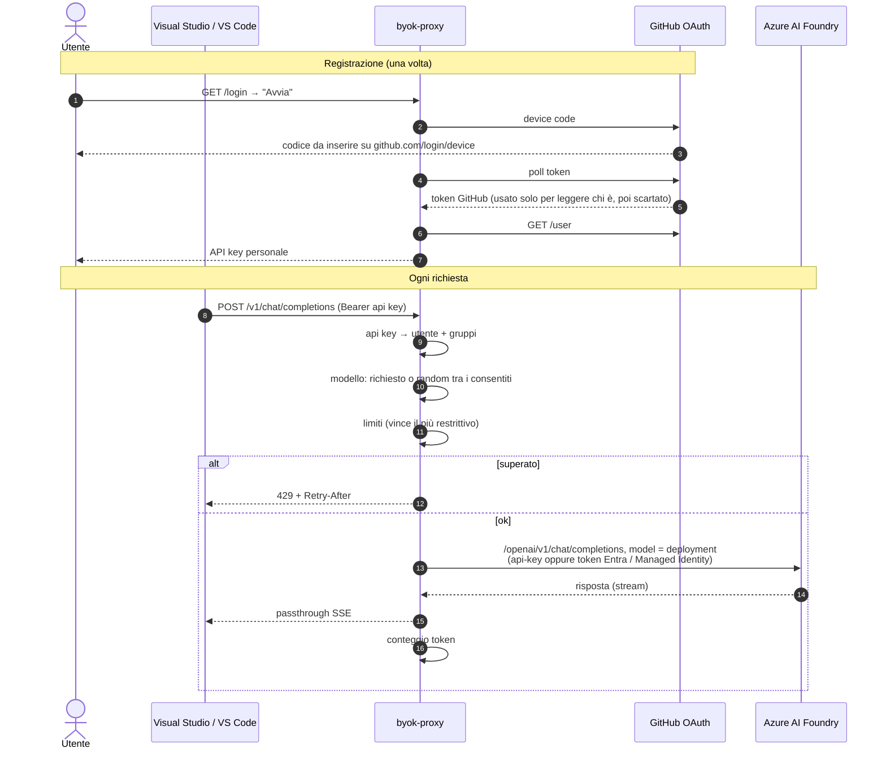

# byok-proxy

Endpoint OpenAI-compatibile da collegare come **modello custom (Bring Your Own Key)** in
Visual Studio / VS Code con GitHub Copilot. Il proxy:

1. **riconosce chi fa la richiesta** dall'API key personale (ottenuta col login GitHub);
2. applica **limiti per utente, gruppo, modello, o modello su utenti/gruppi specifici**;
3. sceglie il modello (per ora **a caso** tra quelli consentiti, se il client chiede `auto`);
4. inoltra la chat ad **Azure AI Foundry** con la credenziale del servizio (chiave API, Entra ID o
   Managed Identity), e registra tutto per la dashboard admin.

Zero dipendenze esterne: Node ≥ 22.13 (`fetch`, SQLite `node:sqlite` e test runner integrati).
Pensato per centinaia/migliaia di account: misurato fino a 10.000 clienti e 2 milioni di richieste
(vedi [Prestazioni](#prestazioni-misurate)).

Gira in Docker con un'immagine distroless da 52 MB compressi (vedi [Docker](#docker)).

## Flusso



## Avvio

```bash
cp config.example.json config.json   # poi modificalo
export GITHUB_OAUTH_CLIENT_ID=...    # OAuth App dell'organizzazione con device flow abilitato
npm start                             # http://127.0.0.1:8787
npm test
```

| Variabile | Default | Cosa fa |
|---|---|---|
| `CONFIG_PATH` | `config.json` | file di configurazione |
| `DB_PATH` | `./data/proxy.db` | database SQLite (clienti, log, riepiloghi) |
| `ADMIN_TOKEN` | — | abilita la dashboard `/admin` |
| `GITHUB_OAUTH_CLIENT_ID` | — | OAuth App per il login dei clienti |
| `AZURE_FOUNDRY_ENDPOINT` | da config | endpoint della risorsa Azure |
| `AZURE_AUTH` | `key` | `key`, `entra` o `managed-identity` |
| `AZURE_FOUNDRY_API_KEY` | — | chiave API (con `AZURE_AUTH=key`) |
| `AZURE_TENANT_ID`, `AZURE_CLIENT_ID`, `AZURE_CLIENT_SECRET` | — | service principal (con `entra`); `AZURE_CLIENT_ID` anche per identità user-assigned |
| `EVENTS_RETENTION_DAYS` | `90` | giorni di log dettagliato conservati |
| `ROLLUP_RETENTION_DAYS` | `400` | giorni di riepiloghi (grafici, totali) conservati |
| `USERS_DB` | `./data/users.json` | vecchio file utenti, importato una sola volta nel DB se presente |
| `HOST`, `PORT` | `127.0.0.1`, `8787` | indirizzo di ascolto |

## Azure AI Foundry

Il proxy usa l'**API v1** di Azure OpenAI / Foundry: `<endpoint>/openai/v1/chat/completions`,
senza `api-version`. Vanno bene sia `https://<risorsa>.openai.azure.com` sia
`https://<risorsa>.services.ai.azure.com`; il campo `model` inviato ad Azure è il **nome del
deployment**.

```jsonc
"provider": {
  "type": "azure-foundry",
  "endpoint": "https://NOME-RISORSA.openai.azure.com",   // o AZURE_FOUNDRY_ENDPOINT
  "auth": "key"                                           // o AZURE_AUTH: key | entra | managed-identity
},
"models": [
  // id = nome che vedono gli utenti in VS Code; deployment = nome del deployment su Azure
  { "id": "gpt-4.1-mini", "name": "GPT-4.1 mini", "deployment": "gpt-41-mini" },
  { "id": "DeepSeek-R1", "deployment": "DeepSeek-R1" }
]
```

| Auth | Quando | Cosa serve |
|---|---|---|
| `key` | test, setup semplici | `AZURE_FOUNDRY_API_KEY` (header `api-key`) |
| `entra` | produzione fuori da Azure | service principal: `AZURE_TENANT_ID`, `AZURE_CLIENT_ID`, `AZURE_CLIENT_SECRET` |
| `managed-identity` | Azure Container Apps, App Service, VM, AKS | identità gestita assegnata al servizio |

Con `entra` e `managed-identity` il token (scope `https://ai.azure.com/.default`) viene richiesto
una volta, tenuto in cache e rinnovato 5 minuti prima della scadenza; le richieste concorrenti
condividono lo stesso rinnovo. All'identità va dato il ruolo **Cognitive Services OpenAI User**
sulla risorsa. All'avvio il proxy verifica subito la credenziale: se è sbagliata si ferma con un
errore leggibile (senza segreti nei log). I `429` di Azure arrivano al client con `Retry-After`.

Per un endpoint OpenAI-compatibile qualsiasi c'è anche `"type": "openai-compatible"` con
`baseUrl` (URL completo di `/chat/completions`) e chiave in `OPENAI_API_KEY`.

## Collegarlo a VS Code (Copilot BYOK)

Chat → selettore modelli → **Manage Models** → **OpenAI Compatible**, oppure in `settings.json`:

```jsonc
"github.copilot.chat.customOAIModels": {
  "auto": {
    "name": "Proxy aziendale (auto)",
    "url": "https://proxy.example.com/v1",
    "toolCalling": true,
    "vision": false,
    "maxInputTokens": 128000,
    "maxOutputTokens": 16000,
    "requiresAPIKey": true
  }
}
```

Come API key si incolla quella ottenuta da `/login`. Il proxy accetta sia `/v1/chat/completions`
sia `/chat/completions`. In Visual Studio vale lo stesso schema (provider compatibile OpenAI,
URL del proxy, API key personale): verifica che la tua versione supporti endpoint custom.

## Endpoint

| Metodo | Percorso | Auth | Descrizione |
|---|---|---|---|
| GET | `/healthz` | no | stato |
| GET | `/login` | no | pagina di registrazione |
| POST | `/login/start` | no | avvia device flow, ritorna codice e `handle` |
| POST | `/login/poll` | no | `{handle}` → `pending` oppure `{apiKey}` |
| GET | `/v1/models` | api key | `auto` + modelli consentiti all'utente |
| POST | `/v1/chat/completions` | api key | chat, streaming e non |
| GET | `/admin` | token admin (in pagina) | dashboard |
| GET | `/admin/api/*` | token admin (Bearer) | API della dashboard |

Risposte di chat con header `X-Selected-Model`. Errori in formato OpenAI (`{error:{message,type}}`).

## Dashboard admin

Imposta `ADMIN_TOKEN` (o `admin.token` in config) e apri `/admin`: inserisci il token e vedi
tutto. Senza token l'area è disattivata (403). La pagina non contiene dati: chiama le API
`/admin/api/*`, autenticate con `Authorization: Bearer <ADMIN_TOKEN>`.

- **Panoramica:** KPI (richieste, token, bloccate, errori, clienti attivi, latenza media), grafici
  richieste/token al giorno (7/30/90/365), classifiche clienti e modelli. Grafici con hover e vista
  tabella; tema chiaro/scuro.
- **Clienti:** elenco paginato (50 per pagina) con ricerca, filtri e ordinamento fatti sul server;
  dettaglio per cliente (gruppi, modelli consentiti, utilizzo per modello, limiti in corso, ultime
  richieste). Azioni: **attiva/disattiva**, **revoca** (per i
  clienti registrati via login), **modifica gruppi**. Le api key e i token GitHub non vengono mai
  esposti: solo un hint mascherato e la presenza/assenza del token.
- **Modelli / Eventi / Regole:** utilizzo per modello con latenza media; log di tutte le richieste
  (100 per volta, "carica altri", filtri per esito e ricerca per cliente o modello); regole attive
  (sola lettura, dal file di config).

### Dati e database

Tutto sta in un file SQLite (`DB_PATH`), modalità WAL:

- **`users`**: clienti. Le api key sono salvate **solo come hash SHA-256** più un hint mascherato;
  ogni nuovo login emette una nuova chiave e invalida la precedente. I clienti in config vengono
  sincronizzati all'avvio: le modifiche fatte dalla dashboard (attiva/disattiva, gruppi) restano
  finché la loro voce in config non cambia; chi viene tolto dalla config non entra più.
- **`events`**: una riga per richiesta (anche bloccate ed errori), conservata `EVENTS_RETENTION_DAYS`.
- **riepiloghi** per giorno, giorno×cliente, giorno×modello e giorno×cliente×modello, aggiornati
  nella stessa transazione degli eventi. KPI, grafici e classifiche leggono solo da qui: il costo
  dipende da giorni × clienti, non dal numero di richieste.

Come resta veloce:
- gli eventi vanno in un buffer e si scrivono a lotti (ogni secondo, o subito dopo la richiesta se
  il lotto è pieno): la risposta al client non aspetta mai il disco;
- clienti ed eventi sono pagine con filtri e ordinamento lato server; gli eventi usano un cursore,
  quindi la pagina 1.000 costa come la prima;
- la ricerca nel log cerca prima clienti e modelli corrispondenti e poi legge i loro eventi via indice:
  niente scansione del log, nemmeno per testi che non esistono;
- i totali per cliente (lista e classifica) sono calcolati da un **worker thread** con connessione in
  sola lettura e tenuti in cache 5 s, con aggiornamento in background: il thread che serve le chat non
  si blocca per colpa della dashboard. I numeri della lista clienti possono quindi essere indietro di
  qualche secondo; KPI, grafici e log no.

| Metodo | Percorso | Azione |
|---|---|---|
| GET | `/admin/api/overview?days=30` | totali del periodo e stato clienti |
| GET | `/admin/api/clients?q=&status=&sort=&dir=&limit=&offset=&days=` | pagina di clienti con utilizzo |
| GET | `/admin/api/clients/:id?days=30` | dettaglio, limiti, ultimi eventi |
| POST | `/admin/api/clients/:id/enable`·`/disable` | attiva/disattiva |
| POST | `/admin/api/clients/:id/groups` | `{groups:[...]}` |
| DELETE | `/admin/api/clients/:id` | revoca (solo clienti device) |
| GET | `/admin/api/usage?days=30` | serie per giorno, per modello, top clienti |
| GET | `/admin/api/events?q=&outcome=&user=&model=&before=&limit=` | log a cursore (`nextBefore`) |
| GET | `/admin/api/rules` | regole e gruppi noti |

## Regole

Ogni regola ha `match` con tre dimensioni opzionali, in AND (vuota = qualsiasi):
`users`, `groups`, `models`.

**Limiti** (`limits`): `rpm`, `rph`, `rpd` (richieste) e `tokensPerMinute`, `tokensPerHour`,
`tokensPerDay`. Tutte le regole che corrispondono si applicano; basta che una sia superata per
bloccare (vince la più restrittiva). Le richieste bloccate non consumano quota.

**Contatore** (`countBy`): `user` (default, ognuno il suo), `group` (condiviso dal gruppo),
`model` (condiviso da tutti su quel modello), `user+model`, `global`.

**Accesso** (`access`): `deny` toglie i modelli di `match.models` (o tutti) a chi corrisponde;
`allow` è una whitelist: chi corrisponde ad almeno una allow-rule può usare solo l'unione di
quei modelli.

| Caso | Regola |
|---|---|
| per utente | `{"match":{"users":["alice"]},"limits":{"rpd":500}}` |
| per gruppo, ciascuno | `{"match":{"groups":["junior"]},"limits":{"rpm":5}}` |
| per gruppo, condiviso | `{"match":{"groups":["junior"]},"countBy":"group","limits":{"rpd":2000}}` |
| per modello | `{"match":{"models":["openai/gpt-4o"]},"countBy":"model","limits":{"rph":100}}` |
| modello × gruppo | `{"match":{"groups":["junior"],"models":["openai/gpt-4o"]},"access":"deny"}` |
| modello × utente | `{"match":{"users":["alice"],"models":["openai/gpt-4o-mini"]},"access":"allow"}` |

## Docker

```bash
cp config.example.json config.json   # modelli, utenti, regole
cp .env.example .env                 # ADMIN_TOKEN, GITHUB_OAUTH_CLIENT_ID, credenziali Azure
docker compose up -d --build         # http://localhost:8787
```

oppure senza Compose:

```bash
docker build -t byok-proxy .
docker run -d --name byok-proxy -p 8787:8787 --env-file .env \
  --read-only --cap-drop ALL --security-opt no-new-privileges:true \
  -v "$PWD/config.json:/config/config.json:ro" -v byok-data:/data byok-proxy
```

L'immagine:
- **due stage**: il primo esegue tutti i test unitari (se uno fallisce la build si ferma), il
  secondo è **distroless nonroot**: niente shell né package manager, utente `65532`;
- **52 MB compressi** (204 MB su disco, quasi tutto Node; l'applicazione sono 188 KB), nessuna
  dipendenza npm;
- scrive solo nel volume `/data` (DB SQLite), quindi gira con **filesystem in sola lettura**;
- **healthcheck** integrato (`/healthz`, controlla anche il DB);
- Node è PID 1 e gestisce **SIGTERM**: scrive gli eventi in buffer e chiude il DB prima di uscire.

La config va montata in `/config/config.json`; i segreti arrivano da variabili d'ambiente. Il
proxy parla HTTP: in produzione mettilo dietro TLS (su **Azure Container Apps** l'ingress lo fa
già, e con `AZURE_AUTH=managed-identity` non serve nessun segreto per Azure).

### Test end-to-end del container

`npm run e2e:docker` (richiede docker, node, openssl) costruisce l'immagine e la prova contro un
finto Azure AI Foundry in HTTPS che simula anche Entra ID, Managed Identity e l'OAuth di GitHub:

1. chiave API: chat e streaming, deployment corretto, accessi per gruppo, limiti, 429 di Azure con
   `Retry-After`, login GitHub, dashboard e API admin (31 verifiche);
2. hardening: processo uid 65532 su filesystem in sola lettura, nessuna capability;
3. persistenza: una richiesta inviata subito prima di `docker stop` è ancora nel DB dopo il riavvio;
4. Entra ID e Managed Identity: un solo token per tutte le richieste (cache);
5. config errata: il container si ferma con exit 1 e un errore leggibile, senza segreti nei log.

## Struttura

```
src/config.js        caricamento e validazione config
src/db.js            SQLite: schema, migrazioni, transazioni
src/store.js         clienti su DB + cache in memoria, api key hashate
src/auth.js          device flow GitHub, lettura api key
src/models.js        modelli consentiti, scelta random
src/limits.js        motore limiti (finestre fisse, O(1))
src/provider.js      inoltro ad Azure AI Foundry v1 / endpoint OpenAI-compatibile
src/azure-credential.js  chiave API, Entra ID, Managed Identity (token in cache)
src/healthcheck.js   healthcheck del container
src/metrics.js       metriche: scrittura a lotti, riepiloghi, query, retention
src/usage-cache.js   totali per cliente in cache, calcolati nel worker
src/usage-worker.js  worker thread in sola lettura per gli aggregati pesanti
src/admin.js         API admin + gestione clienti
src/server.js        HTTP
src/dashboard.html   pagina dashboard
src/dashboard/       JS dashboard (servito unito come /admin/dashboard.js)
tests/               100 test (unit + integrazione con upstream simulato)
tests/e2e/           finto Azure in HTTPS + verifiche end-to-end del container
scripts/bench.mjs    benchmark di scala (npm run bench)
scripts/e2e-docker.sh  test end-to-end dell'immagine (npm run e2e:docker)
Dockerfile, docker-compose.yml, .env.example
```

## Prestazioni misurate

`npm run bench` crea clienti ed eventi in un DB su file e misura le query della dashboard e le API
HTTP. Valori p50 su questo ambiente (container cloud, Node 22):

| | 2.000 clienti · 500k richieste | 10.000 clienti · 2M richieste |
|---|---|---|
| `GET /admin/api/overview` | 1,5 ms | 2,3 ms |
| `GET /admin/api/usage?days=90` | 4,2 ms | 4,0 ms |
| `GET /admin/api/clients` (50 righe) | 1,9 ms | 6,2 ms |
| `GET /admin/api/events` (100 righe) | 1,4 ms | 1,5 ms |
| `GET /admin/api/clients/:id` | 1,7 ms | 1,8 ms |
| ricerca nel log senza risultati | 0,2 ms | 0,8 ms |
| totali per cliente a cache fredda (nel worker) | 76 ms | 441 ms |
| ↳ blocco massimo del thread delle chat nel frattempo | 6 ms | 25 ms |
| scrittura eventi | ~70.000/s | ~44.000/s |
| lookup api key / controllo limiti | ~1 µs / ~2-3 µs | ~1 µs / ~3 µs |
| DB su disco | 131 MB | 541 MB |
| memoria del processo a regime | 102 MB | 174 MB |

## Limiti noti

- Una sola istanza: contatori dei limiti in memoria e DB SQLite locale. Per più istanze dietro un
  bilanciatore servono contatori condivisi (Redis) e un DB server (PostgreSQL): le interfacce di
  `RateLimiter`, `UserStore` e `MetricsStore` restano le stesse.
- Il proxy è verificato contro un finto Azure che riproduce l'API v1; prima di andare in produzione
  fai una prova con la tua risorsa reale e i tuoi deployment (alcuni modelli di ragionamento, ad
  esempio, rifiutano parametri come `max_tokens` o `temperature`: l'errore di Azure arriva al client).
- Il proxy vede i prompt in chiaro: trattalo come servizio interno con dati sensibili.
- Il benchmark usa dati sintetici su un solo host; i numeri reali dipendono da disco e CPU.
