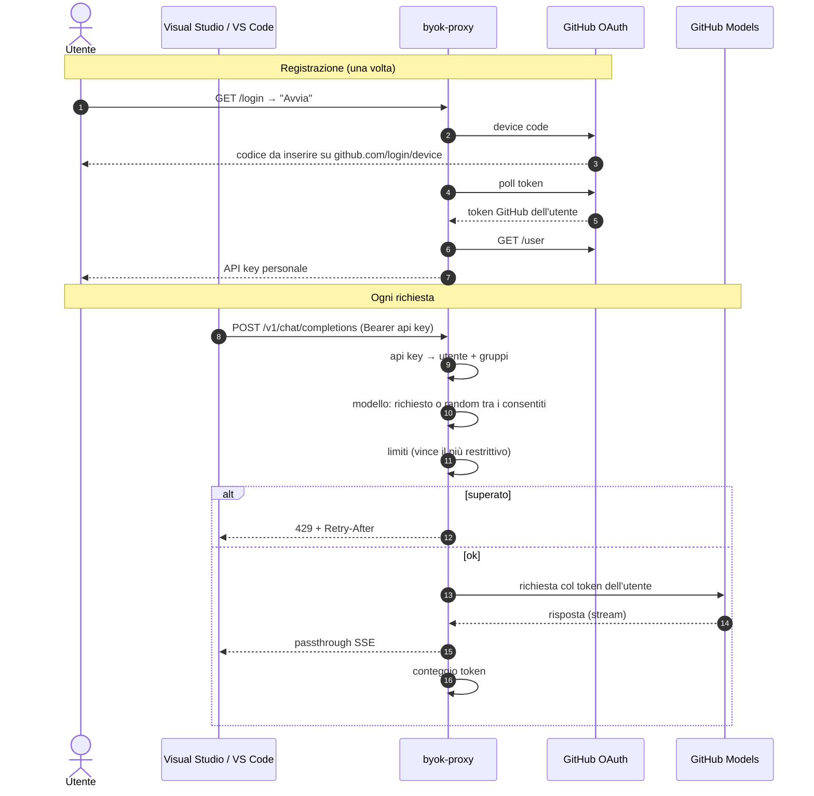

# byok-proxy

Endpoint OpenAI-compatibile da collegare come **modello custom (Bring Your Own Key)** in
Visual Studio / VS Code con GitHub Copilot. Il proxy:

1. **riconosce chi fa la richiesta** dall'API key personale;
2. applica **limiti per utente, gruppo, modello, o modello su utenti/gruppi specifici**;
3. sceglie il modello (per ora **a caso** tra quelli consentiti, se il client chiede `auto`);
4. chiama il modello **autenticato come quell'utente** (token GitHub ottenuto col suo consenso).

Zero dipendenze esterne: Node ≥ 20 (`fetch` e test runner integrati).

> **Provider.** Il modulo `src/provider.js` chiama l'API ufficiale **GitHub Models**
> (`models.github.ai`). Questa API ha una contabilità propria (tier gratuito limitato, poi a
> consumo) e **non** usa i crediti del piano Copilot. L'accesso ai crediti del piano tramite
> l'endpoint interno di Copilot non è implementato. Il provider è isolato: per cambiare backend
> si sostituisce solo quel modulo.

## Flusso



## Avvio

```bash
cp config.example.json config.json   # poi modificalo
export GITHUB_OAUTH_CLIENT_ID=...    # OAuth App dell'organizzazione con device flow abilitato
npm start                             # http://127.0.0.1:8787
npm test
```

Variabili: `CONFIG_PATH` (default `config.json`), `USERS_DB` (default `./data/users.json`,
utenti registrati via login), `HOST`, `PORT`.

## Collegarlo a VS Code (Copilot BYOK)

Chat → selettore modelli → **Manage Models** → **OpenAI Compatible**, oppure in `settings.json`:

```jsonc
"github.copilot.chat.customOAIModels": {
  "auto": {
    "name": "Proxy aziendale (auto)",
    "url": "https://proxy.example.com/v1",
    "toolCalling": true,
    "vision": false,
    "maxInputTokens": 128000,
    "maxOutputTokens": 16000,
    "requiresAPIKey": true
  }
}
```

Come API key si incolla quella ottenuta da `/login`. Il proxy accetta sia `/v1/chat/completions`
sia `/chat/completions`. In Visual Studio vale lo stesso schema (provider compatibile OpenAI,
URL del proxy, API key personale): verifica che la tua versione supporti endpoint custom.

## Endpoint

| Metodo | Percorso | Auth | Descrizione |
|---|---|---|---|
| GET | `/healthz` | no | stato |
| GET | `/login` | no | pagina di registrazione |
| POST | `/login/start` | no | avvia device flow, ritorna codice e `handle` |
| POST | `/login/poll` | no | `{handle}` → `pending` oppure `{apiKey}` |
| GET | `/v1/models` | sì | `auto` + modelli consentiti all'utente |
| POST | `/v1/chat/completions` | sì | chat, streaming e non |

Risposte di chat con header `X-Selected-Model`. Errori in formato OpenAI (`{error:{message,type}}`).

## Regole

Ogni regola ha `match` con tre dimensioni opzionali, in AND (vuota = qualsiasi):
`users`, `groups`, `models`.

**Limiti** (`limits`): `rpm`, `rph`, `rpd` (richieste) e `tokensPerMinute`, `tokensPerHour`,
`tokensPerDay`. Tutte le regole che corrispondono si applicano; basta che una sia superata per
bloccare (vince la più restrittiva). Le richieste bloccate non consumano quota.

**Contatore** (`countBy`): `user` (default, ognuno il suo), `group` (condiviso dal gruppo),
`model` (condiviso da tutti su quel modello), `user+model`, `global`.

**Accesso** (`access`): `deny` toglie i modelli di `match.models` (o tutti) a chi corrisponde;
`allow` è una whitelist: chi corrisponde ad almeno una allow-rule può usare solo l'unione di
quei modelli.

| Caso | Regola |
|---|---|
| per utente | `{"match":{"users":["alice"]},"limits":{"rpd":500}}` |
| per gruppo, ciascuno | `{"match":{"groups":["junior"]},"limits":{"rpm":5}}` |
| per gruppo, condiviso | `{"match":{"groups":["junior"]},"countBy":"group","limits":{"rpd":2000}}` |
| per modello | `{"match":{"models":["openai/gpt-4o"]},"countBy":"model","limits":{"rph":100}}` |
| modello × gruppo | `{"match":{"groups":["junior"],"models":["openai/gpt-4o"]},"access":"deny"}` |
| modello × utente | `{"match":{"users":["alice"],"models":["openai/gpt-4o-mini"]},"access":"allow"}` |

## Struttura

```
src/config.js        caricamento e validazione config
src/store.js         utenti statici + registrati, api key
src/auth.js          device flow GitHub, lettura api key
src/models.js        modelli consentiti, scelta random
src/limits.js        motore limiti (finestre fisse, O(1))
src/provider.js      chiamata al modello come utente (pluggable)
src/server.js        HTTP
tests/               46 test (unit + integrazione con upstream simulato)
```

## Prestazioni e limiti noti

- Controllo limiti ~2 µs/richiesta con 3 regole (1M controlli in ~2,3 s).
- Streaming in passthrough; per il conteggio token si tiene solo la coda (64 KB) dello stream.
- Contatori in memoria: con più istanze vanno spostati su Redis (stessa interfaccia).
- I token GitHub degli utenti registrati sono salvati in `USERS_DB` in chiaro: proteggi il file
  (permessi, volume cifrato) o sostituisci lo store con un secret manager.
- Il proxy vede i prompt in chiaro: trattalo come servizio interno con dati sensibili.
