# 01 — Architecture

> **The premise.** A traditional multi-agent setup asks *"which agent should handle this?"*.
> CAAO asks *"which capabilities does this request require, and under which conditions?"*.
> The first question hardcodes a topology. The second one derives it.

---

## 1. The four separations

Everything in this implementation exists to keep four concerns from ever touching each other.

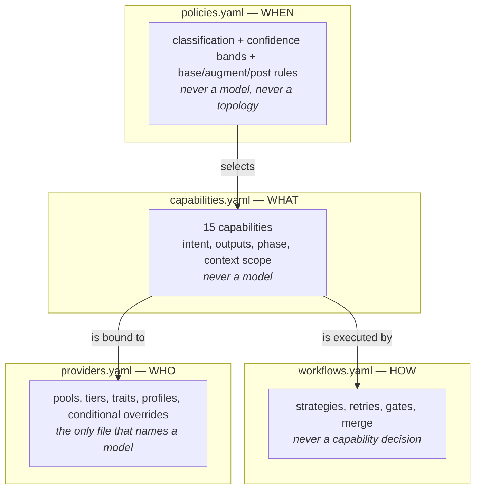

A unit test enforces the separation literally: `capabilities.yaml` and `policies.yaml` must not contain
the substring `omniroute` nor any model identifier. Change the entire model fleet by editing one file.

`providers.yaml` may *read* signals (`understanding`, `complexity`, `touches`) to decide how much
horsepower to spend, but it still never decides *what work is needed*. The two questions stay apart.

---

## 2. End-to-end request flow

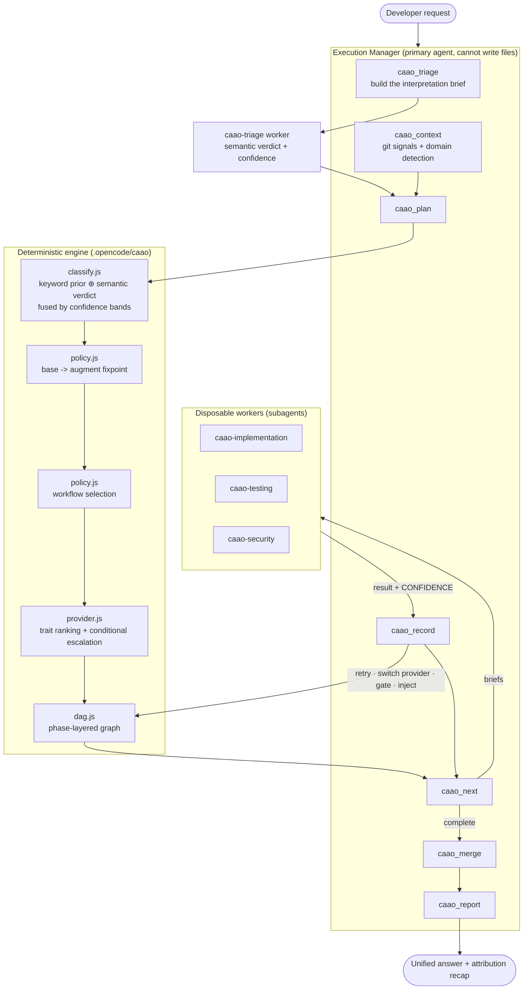

The Execution Manager is a **loop driver**, not a decision maker. Every decision — which capabilities,
which model, what to retry, when to escalate — is computed by the engine from the YAML registries.
This is why the whole orchestration is unit-testable without a single LLM call.

---

## 3. Classification — two layers, fused by confidence

Keywords are fast, free and deterministic, but they only see the words the developer happened to use.
A semantic reading is accurate but costs a model call and can be wrong with confidence. CAAO runs
**both** and fuses them with a rule you declare rather than one hidden in code.

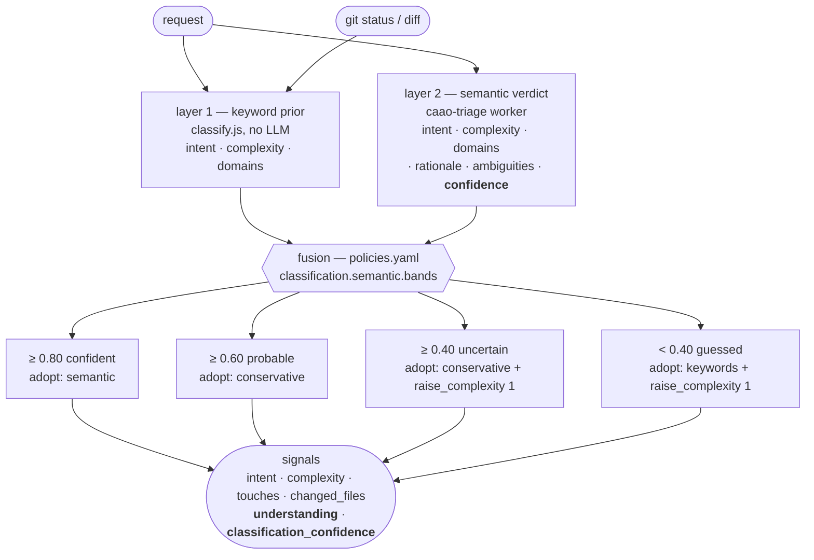

**Adoption modes.**

| Mode | Meaning |
| --- | --- |
| `semantic` | the model's reading wins outright |
| `conservative` | take the model's *intent*, but keep whichever *complexity* is higher |
| `keywords` | discard the model's reading and keep the deterministic prior |

Domains are always **unioned** — a domain either layer noticed is a domain that gets reviewed.
If the two layers disagree on intent and the band is not `confident`, adoption is downgraded to
`on_disagreement` (default `conservative`). `raise_complexity` bumps the final complexity one step up
the ladder, so *not being sure* automatically buys more planning, more review and a stronger model.

| Signal | Values | Derived from |
| --- | --- | --- |
| `intent` | `document`, `migrate`, `optimize`, `refactor`, `debug`, `research`, `rename`, `implement` | fused verdict |
| `complexity` | `trivial`, `medium`, `high`, `critical` | fused verdict, raised by the band |
| `touches` | `auth`, `payments`, `crypto`, `database`, `public_api`, `infrastructure`, `frontend`, `tests` | union of keywords, path globs and the semantic verdict |
| `changed_files` | integer | `git status --porcelain` + `git diff --name-only HEAD~1..HEAD` |
| `understanding` | `confident`, `probable`, `uncertain`, `guessed`, `keywords-only` | the band that was selected |
| `classification_confidence` | `0.00`–`1.00` or `null` | the triage worker's self-assessment |

Two policies turn poor understanding into behaviour, declaratively:

```yaml
unclear-request:        # understanding in [uncertain, guessed]  -> +planning
understanding-collapsed: # classification_confidence < 0.40      -> +review
```

Without a triage verdict the system degrades gracefully to `understanding: keywords-only` and behaves
exactly as it did before the semantic layer existed — a property the test suite pins down on all six
reference scenarios.

Every classification records **evidence** (`evidence.semantic` holds the band, the source, the
rationale, any disagreement and whether complexity was raised), so a plan is always explainable.

---

## 4. Capability resolution — the policy engine

Two stages with different algebra. This is the heart of the system.

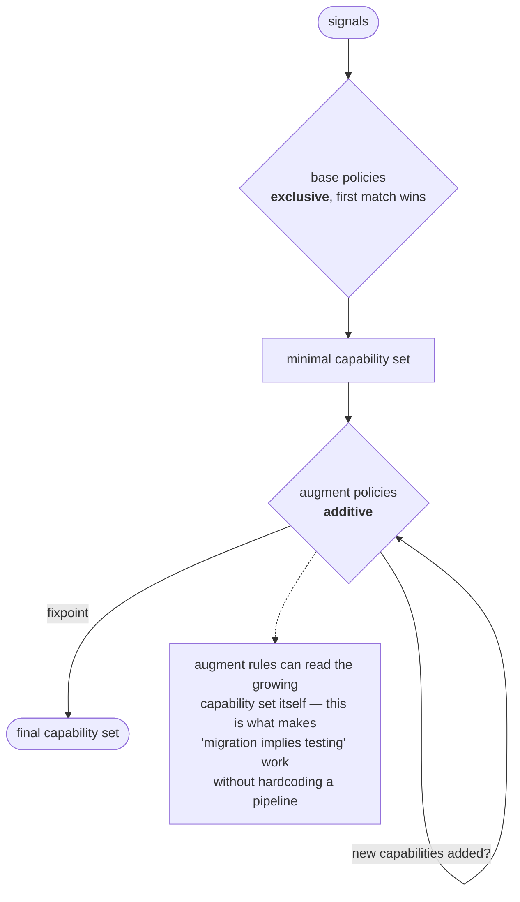

* **base** — exactly one rule fires; it produces the baseline set. A `fallback` rule guarantees a match.
* **augment** — every rule that matches contributes, and the loop re-runs (max 8 passes) with
  `capabilities` exposed as a signal. Composition emerges instead of being enumerated.
* **post** — evaluated *after* a worker reports, on `confidence` and `findings_blocking`.

Concrete composition, generated by the engine for `"Fix the failing unit tests in the billing module"`:

```
base         : defect             -> +implementation, testing
augment      : touches-payments   -> +security, architecture
capabilities : implementation -> testing -> security -> architecture
```

Nobody wrote a "billing bugfix pipeline". `billing` matched the `payments` domain, and the
`touches-payments` policy demanded a security and structural review. That is adaptivity.

---

## 5. Provider resolution — ranking, then conditional escalation

Independent from capability selection, and deliberately so. Resolution happens in two steps: a
**static ranking** picks the default pool for a capability, then **conditional overrides** may replace
that choice when the signals say the request deserves more horsepower.

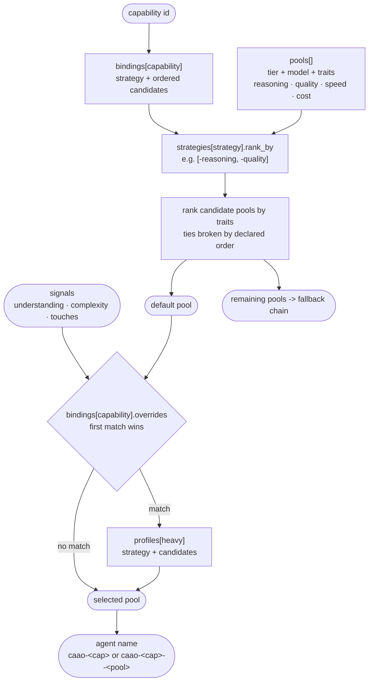

**Pools carry a `tier`.** `heavy` pools are slow, expensive and smart; `standard` pools are fast and
cheap. **Profiles** name a *set* of heavy models rather than one, so you can have several heavy models
and let the ranking strategy choose between them:

```yaml
profiles:
  heavy: { strategy: highest_reasoning, candidates: [opus-5, kimi-code] }
  fast:  { strategy: fastest,           candidates: [kimi-code, opus-5] }
```

**Overrides** are the manoeuvring room. Each carries a `reason` that is reproduced verbatim in the
recap, so an expensive run always explains itself:

```yaml
bindings:
  implementation:
    strategy: balanced
    candidates: [kimi-code, opus-5]
    overrides:
      - when: { understanding: [uncertain, guessed] }
        profile: heavy
        reason: the request was not understood confidently — do not let a fast model guess
      - when: { complexity: critical }
        profile: heavy
        reason: critical blast radius outweighs latency and cost
      - when: { touches: [crypto] }
        profile: heavy
        reason: cryptographic code is not a place to save money
```

`resolveProvider(config, capability, { attempt, signals })` returns the pool, the model, the tier,
`escalated`, `escalationReason` and the fallback chain. Attempt 0 gets the winner, attempt *n* gets the
*n*-th fallback — the retry ladder needs no separate configuration.

**Why one agent per capability *and* pool.** opencode only honours per-agent model and tool settings
from files on disk. So `agents.js` generates a variant for every pool a capability can reach —
`caao-implementation.md` (kimi) and `caao-implementation--opus-5.md` (opus). Escalation is then simply
the engine handing the Execution Manager a different `subagent_type`. **32 agent files** in total.

Result with the current registry, when nothing escalates:

| Capability class | Strategy | Model | Tier |
| --- | --- | --- | --- |
| planning, review, security, architecture, performance, advisor | `highest_reasoning` / `highest_quality` | `claude-opus-5` | heavy |
| implementation, testing, refactoring, documentation, debugging, triage | `balanced` / `fastest` | `kimi-k2.7-code` | standard |

---

## 6. The execution DAG

`dag.js` orders capabilities by **phase rank**, then wires each phase to the phases whose output it
actually consumes. The ordering is a timeline; the wiring is what decides how wide the graph gets.

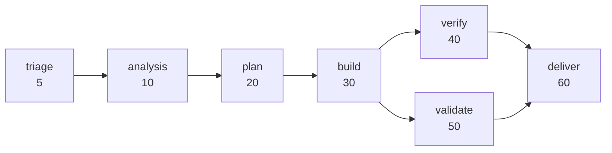

Note that `verify` and `validate` both hang off `build`. Neither reads the other's output, so tests and
reviews are siblings, not a queue. This is not hardcoded — it is `execution.phase_depends_on` in
`workflows.yaml`, and changing it changes the shape of every run.

Rules:

1. Capabilities are sorted by `phaseRank`.
2. A phase's entry nodes depend on the **exit nodes of the phases it declares**, not on whatever
   happened to run immediately before it.
3. Parallelizable capabilities within a phase become siblings.
4. A **non-parallelizable** capability (`planning`, `migration`, `advisor`, `triage`) gets its own
   sub-layer and acts as a barrier.
5. Explicit `requires` on a capability adds edges on top of the phase wiring.
6. A build node becomes `expandable` when a plan node exists **and** the strategy allows `expand_plan`.

Real output for `"Implement OAuth 2.0 authentication with Google and GitHub providers"`:

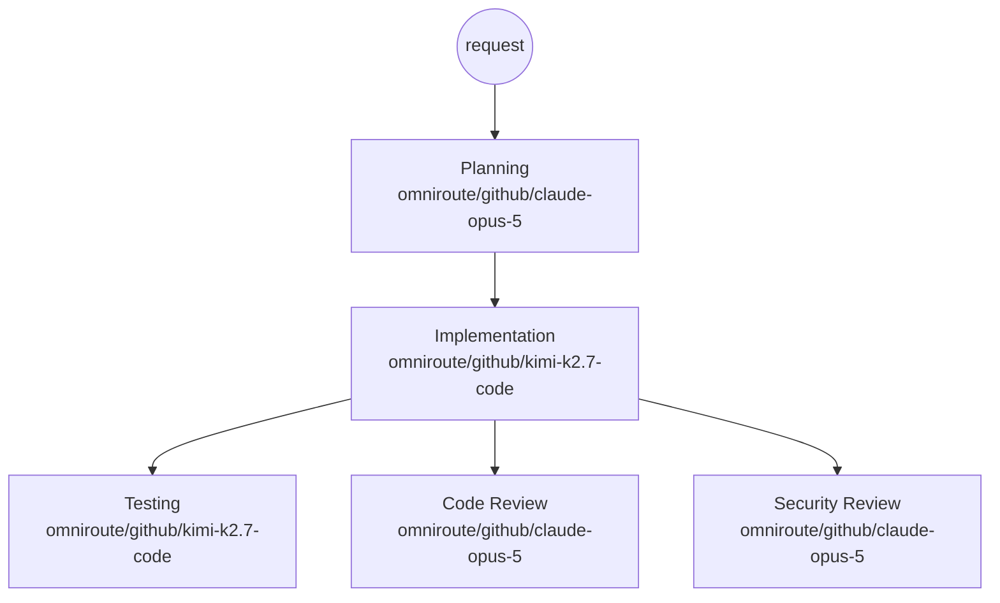

Three waves become two: `testing`, `review` and `security` are dispatched in the same turn and run
concurrently. `caao_next` hands the Execution Manager the whole wave at once, along with the
`maxParallel` budget, and the Execution Manager is required to issue every `task` call in a single
message.

### Reopening the build safely

Parallelism creates a hazard: a review can fail while the tests beside it are still running. When a
validation gate reopens the build, the engine walks the graph forward from the reopened nodes and
invalidates **everything downstream** — finished nodes go back to `pending`, in-flight nodes are
flagged `stale` and their result is discarded on arrival with an explicit `discarded` decision. No
verdict ever describes code that no longer exists.

### Measuring it

`caao_report` returns a `parallelism` block: number of waves (the critical path), the widest wave, the
concurrency of each wave, total model time versus wall-clock time, and the resulting speed-up. If a run
was accidentally serialised, the speed-up is ~1 and it shows.

---

## 7. Workflow strategy selection

The topology is chosen, not fixed.

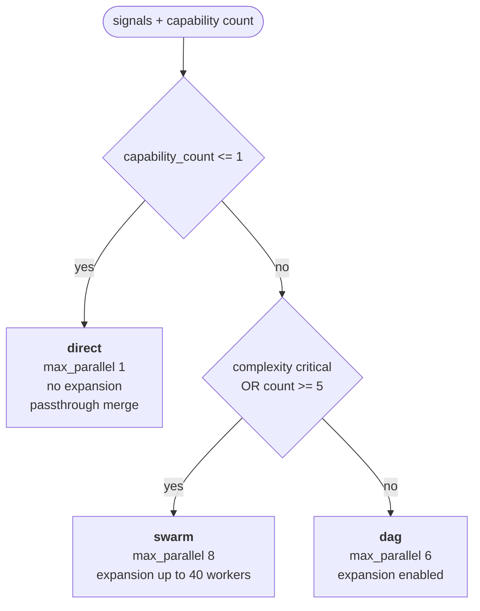

A one-line rename therefore costs exactly one worker and zero orchestration overhead — the paper's
"trivial request must stay trivial" requirement, enforced by `selection`, not by prompt discipline.

---

## 8. Fan-out: dynamic expansion

A planning node does not just produce text; it produces **subtasks**, which the engine materialises as
real nodes at runtime.

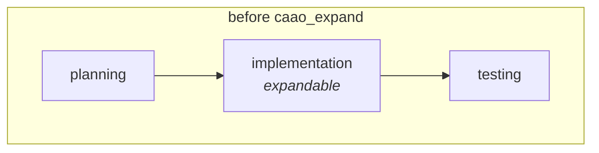

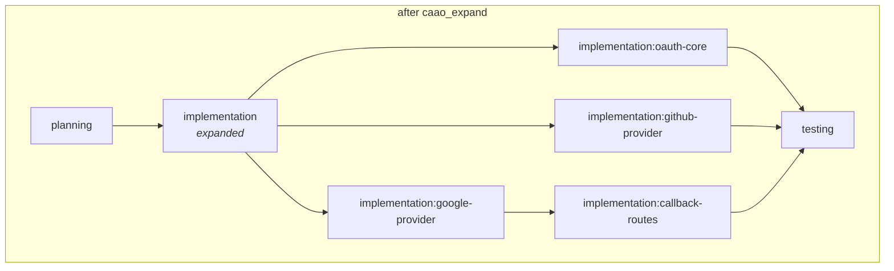

`expandNode()` rewires every downstream dependency from the parent to the children, resolves the
planner's local `depends_on` references between subtasks, and enforces `expand_limit`. The parent is
marked `expanded` — a terminal state that satisfies dependencies without producing output.

**The graph shape is a runtime consequence of the plan, not a design-time decision.**

---

## 9. Worker isolation

Every worker is disposable and blind: it receives a self-contained brief and returns a summary. It
cannot see the run, the other workers, or the graph.

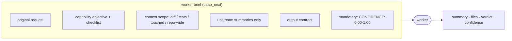

Isolation is enforced by the tool matrix, verified with `opencode debug agent`:

| Agent | mode | `write`/`edit` | `task` | `caao_*` |
| --- | --- | --- | --- | --- |
| `caao` (Execution Manager) | primary | ✗ | ✓ | ✓ |
| `caao-implementation` | subagent | ✓ | ✗ | ✗ |
| `caao-security` | subagent | ✗ | ✗ | ✗ |

The Execution Manager orchestrates but cannot write. Workers write but cannot orchestrate. No worker can
spawn another worker, so recursion is structurally impossible.

> ⚠️ **Implementation note.** opencode honours per-agent `tools` restrictions **only** when they are
> declared in an agent definition on disk. Restrictions injected from a plugin's `config()` hook are
> silently ignored. That is why agents are *generated files*, not runtime objects. See
> [05-operations.md](05-operations.md#generated-agents).

---

## 10. Confidence, retries and escalation

Every worker must end its answer with `CONFIDENCE: <0.00-1.00>`. The engine compares it against the
capability's own `confidence_floor` (0.50 for `advisor`, 0.85 for `security` and `migration`).

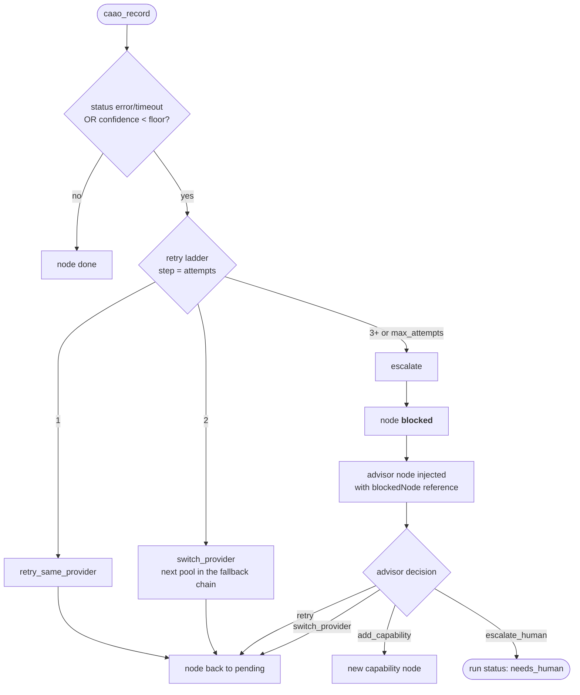

Escalation is a capability like any other. The `advisor` runs on the highest-reasoning model with a
deliberately low confidence floor, because its job is to make a judgement call, not to be certain.

---

## 11. Validation gates and the reopen loop

Validation is **conditional and blocking**, not a decorative final step.

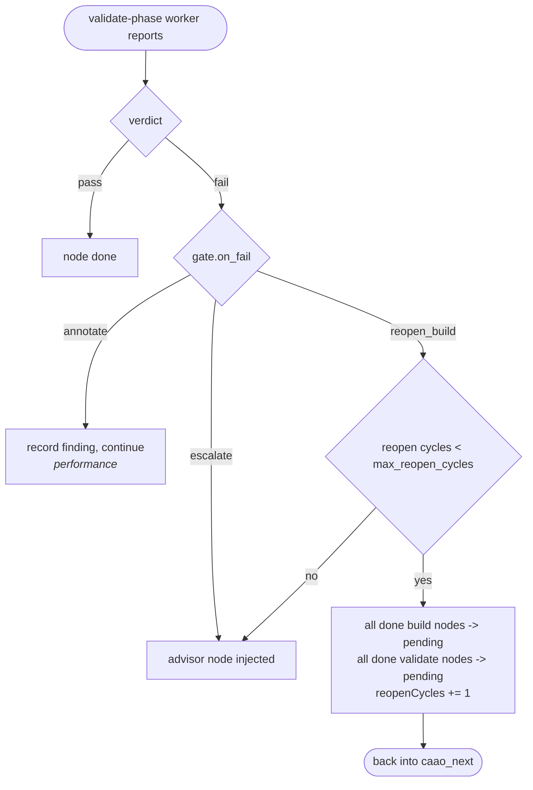

| Gate | blocking | on fail |
| --- | --- | --- |
| `review` | yes | `reopen_build` |
| `security` | yes | `reopen_build` |
| `testing` | yes | `reopen_build` |
| `architecture` | yes | `escalate` |
| `performance` | no | `annotate` |

A failing security review therefore *sends the code back to the build phase* — automatically, bounded to
2 cycles, with the whole decision recorded in the run log.

On top of gates, **post policies** react to any recorded result:

| Policy | Condition | Effect |
| --- | --- | --- |
| `low-confidence` | `confidence < 0.60` | inject `advisor` |
| `collapsed-confidence` | `confidence < 0.40` | inject `advisor`, mark run `needs_human` |
| `blocking-findings` | `findings_blocking >= 1` | inject `implementation` |

---

## 12. Merge

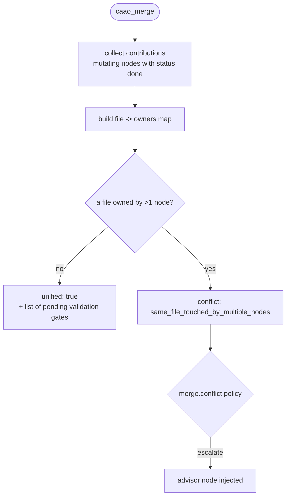

The merge report also lists **pending gates**, so the Execution Manager can never present a result as
final while a blocking validation is still outstanding.

---

## 13. Run state and auditability

Every run is persisted to `.opencode/state/runs/<runId>.json` and contains the complete decision record:

```
run
├── id, createdAt, request, status
├── signals          intent · complexity · touches · changed_files · understanding
│                    · classification_confidence · evidence
├── capabilities     the resolved set
├── policyTrace      every base/augment/post rule that fired, with its reason
├── strategy         selected workflow + the rule that selected it
├── graph            nodes (status, attempts, provider, providerHistory, results,
│                    dependsOn, startedAt, endedAt), signals, maxParallel
├── reopenCycles
└── log              planned · dispatch · expanded · recorded · merged
```

`caao_status` returns all of it, plus a live mermaid rendering of the graph. Any answer the system
produces can be traced back to the rule that caused it.

---

## 13b. Attribution — who actually did the work

`providerHistory` records, for every attempt of every node, which pool and model executed it and why.
`report(runId)` folds that into the recap the Execution Manager is required to print:

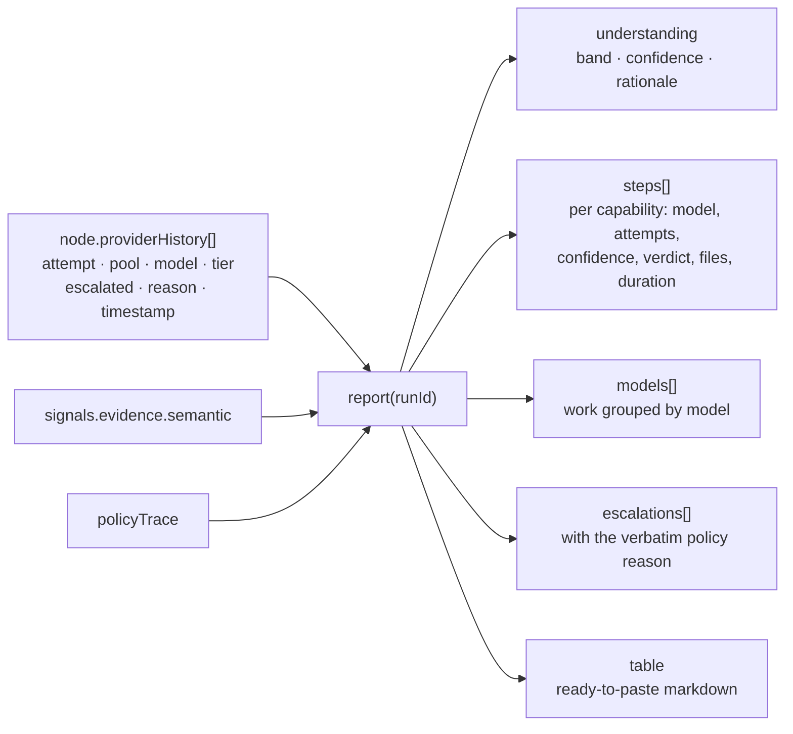

A real recap, generated by `node tests/integration/examples.mjs`:

| Phase | Capability | Model | Attempts | Confidence | Time |
| --- | --- | --- | --- | --- | --- |
| plan | Planning | `omniroute/github/claude-opus-5` | 1 | 0.94 | 2ms |
| build | Implementation | `omniroute/github/kimi-k2.7-code` | 1 | 0.86 | 2ms |
| verify | Testing | `omniroute/github/kimi-k2.7-code` | 1 | 0.91 | 2ms |
| validate | Code Review | `omniroute/github/claude-opus-5` | 1 | 0.90 | 2ms |
| validate | Security Review | `omniroute/github/claude-opus-5` | 1 | 0.93 | 4ms |

Escalated steps are marked `⬆` and carry the reason from `providers.yaml`. This is the difference
between a black box and an auditable system: you can always answer *which model wrote this line, and
what made the system pick it*.

---

## 14. Module map

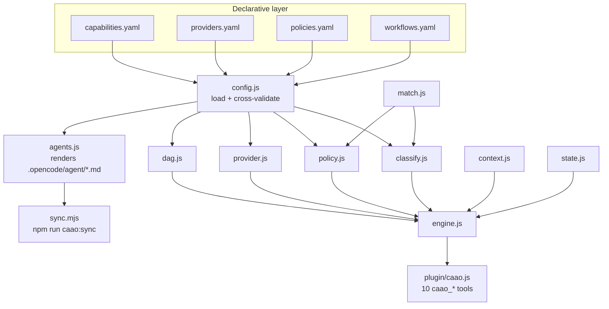

| Module | Responsibility |
| --- | --- |
| `config.js` | load + cross-validate the four registries |
| `match.js` | the shared `when` mini-language |
| `classify.js` | keyword prior, `normalizeTriage`, band fusion |
| `policy.js` | base / augment / post resolution, strategy selection |
| `provider.js` | ranking, `resolveOverride`, `poolsFor`, `agentName` |
| `dag.js` | phase-layered graph, expansion, mermaid |
| `engine.js` | `triageBrief`, `plan`, `next`, `record`, `expand`, `merge`, `status`, `report` |
| `agents.js` | renders one agent file per capability × pool |
| `context.js` | git signals |
| `state.js` | run persistence |

`config.js` cross-validates on load and refuses to start on: an unknown phase, a capability with no
provider binding, a policy selecting a capability that does not exist, an unknown strategy, profile or
pool, an override with no `when` or no target, or a workflow rule pointing at a missing strategy.
Misconfiguration fails at boot, not mid-run.

---

Next: [02 — Configuration reference](02-configuration.md)
