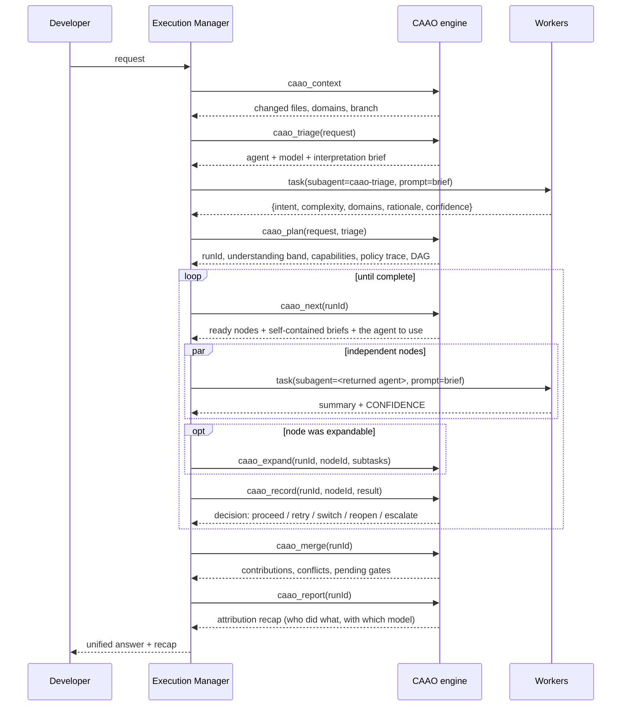

# 03 — Orchestration tools

The plugin [.opencode/plugin/caao.js](../.opencode/plugin/caao.js) exposes the engine as twelve tools.
They are available **only** to the Execution Manager (`caao`). Every worker agent has all twelve set to
`false`, which is what makes recursive orchestration structurally impossible.

The plugin also does two things nobody has to call. It listens to opencode's `message.updated`
events and bills the **real** token counts to the task that produced them, and it reads the token
savings that compression MCPs publish in their own tool output. Neither is a tool, because neither
should depend on a model remembering to report a number it cannot see.



> The `agent` name returned by `caao_next` **encodes the model the engine selected**
> (`caao-implementation` vs `caao-implementation--opus-5`). Dispatching a different agent silently
> overrides the escalation policy, which is why the Execution Manager is forbidden from doing so.

---

## `caao_triage`

Builds the brief for the semantic interpretation pass, and tells the Execution Manager which agent to
run it with. It does **not** call a model itself — the engine never does.

| Arg | Type | Req | Description |
| --- | --- | --- | --- |
| `request` | string | ✓ | The developer request, verbatim. |

Returns `{ agent, model, prompt }`. The worker's raw reply is passed straight to `caao_plan` as
`triage`; `normalizeTriage` extracts the JSON object even if it is wrapped in prose or a fenced block.

---

## `caao_context`

Cheap, read-only pre-flight. Safe to call before planning.

| Arg | Type | Req | Description |
| --- | --- | --- | --- |
| `request` | string | – | Used for domain detection. |

Returns `{ cwd, branch, changedFiles, changed_files, isGitRepo, domains }`.

---

## `caao_plan`

Classifies, resolves capabilities, selects a strategy, builds the DAG and persists the run.

| Arg | Type | Req | Description |
| --- | --- | --- | --- |
| `request` | string | ✓ | The developer request, verbatim. |
| `intent` | string | – | Override the classified intent. |
| `complexity` | `trivial`\|`medium`\|`high`\|`critical` | – | Override the classified complexity. |
| `triage` | string | – | The raw reply of the `caao-triage` worker. Omit it and the system falls back to keyword classification (`understanding: keywords-only`). |

Returns:

```jsonc
{
  "runId": "run-20250612T101500Z-a4f1",
  "classification": { "intent": "implement", "complexity": "high", "touches": ["auth"],
                      "understanding": "confident", "classification_confidence": 0.88, "evidence": {…} },
  "capabilities": ["planning", "implementation", "review", "security", "testing"],
  "policyTrace": [
    { "stage": "base",    "policy": "high-complexity",           "added": ["planning","implementation","review"] },
    { "stage": "augment", "policy": "touches-auth",              "added": ["security"], "reason": "authentication surface requires an adversarial review" },
    { "stage": "augment", "policy": "mutating-work-needs-proof", "added": ["testing"],  "reason": "non-trivial implementations must be proven" }
  ],
  "strategy": { "id": "swarm", "rule": "swarm", "maxParallel": 8 },
  "nodes": [ { "id": "planning", "agent": "caao-planning", "model": "…", "tier": "heavy", "escalated": false, "escalationReason": null, "dependsOn": [], "expandable": false } ],
  "mermaid": "flowchart TD…"
}
```

Overrides are recorded in `evidence.*.overridden`, so an override never silently rewrites history.

---

## `caao_next`

Returns the nodes whose dependencies are satisfied and marks them `running`. Respects
`max_parallel` minus the nodes already in flight.

| Arg | Type | Req |
| --- | --- | --- |
| `runId` | string | ✓ |

Returns `{ runId, complete, blocked[], running[], dispatch[], maxParallel, inFlight }` where each
`dispatch` entry is:

| Field | Meaning |
| --- | --- |
| `nodeId` | Identifier to pass back to `caao_record`. |
| `capability` | Capability id. |
| `agent` | Subagent to invoke, e.g. `caao-security`. **Use exactly this name** — it encodes the selected model. |
| `model` | Resolved model (informational — the agent file already binds it). |
| `contextScope` | `diff` \| `tests` \| `touched` \| `repo-wide`. |
| `expandable` | If `true`, call `caao_expand` with the subtasks the worker returned. |
| `prompt` | The complete, self-contained worker brief. |

> **Everything returned in one call is independent and must be dispatched in parallel.** Serialising them
> silently destroys the concurrency the DAG was built to express. A wave commonly mixes phases: tests
> and reviews both read the build output, so they come back together. `maxParallel` is the budget the
> strategy allows and `inFlight` is how much of it is currently used.

The brief always ends with the mandatory contract:

```
End your answer with a single line:
CONFIDENCE: <0.00-1.00>
```

---

## `caao_expand`

Materialises a planner's subtasks as real nodes.

| Arg | Type | Req | Description |
| --- | --- | --- | --- |
| `runId` | string | ✓ | |
| `nodeId` | string | ✓ | Must be `expandable`. |
| `subtasks` | array | ✓ | Units of work from the planning worker. |

Each subtask: `{ id?, title, capability?, description?, depends_on?, files? }`.

* Children are named `<parent>:<subtaskId>`.
* `depends_on` may reference sibling subtask ids; they are resolved to child node ids.
* Every downstream node that depended on the parent is rewired to depend on all children.
* The parent becomes `expanded` — terminal, produces no output.
* Exceeding `expand_limit` throws.

---

## `caao_record`

Reports a worker result and receives the engine's decision.

| Arg | Type | Req | Description |
| --- | --- | --- | --- |
| `runId` | string | ✓ | |
| `nodeId` | string | ✓ | |
| `status` | `ok`\|`error`\|`timeout` | – | Default `ok`. |
| `confidence` | 0–1 | – | The worker's self-reported confidence. |
| `summary` | string | – | What the worker produced. Fed to downstream briefs. |
| `files` | string[] | – | Files changed — drives merge conflict detection. |
| `verdict` | `pass`\|`fail` | – | Validation capabilities only. Drives the gates. |
| `findings_blocking` | int ≥ 0 | – | Triggers the `blocking-findings` post policy. |
| `decision` | `retry`\|`switch_provider`\|`add_capability`\|`escalate_human` | – | **advisor only**. |
| `capability` | string | – | Target of an advisor `add_capability`. |
| `request_capabilities` | string[] | – | Capability chaining requested by the worker. |
| `tokens_in` | int ≥ 0 | – | Prompt tokens consumed. Billed at the pool's `input_per_mtok`. |
| `tokens_out` | int ≥ 0 | – | Completion tokens produced. Billed at `output_per_mtok`. |
| `tokens_cached` | int ≥ 0 | – | Cached prompt tokens. Billed at `cached_multiplier` (default 0.1) of the input rate. |

Token counts are optional. Omitting them does not break anything — the run is simply marked
*unmetered* and the console shows `—` instead of inventing a zero. See
[docs/06-dashboard.md](06-dashboard.md#3-the-cost-model).

Returns `{ runId, node, nodeStatus, decisions[], runStatus, remaining }`. Possible `decisions[].action`:

| Action | Cause |
| --- | --- |
| `retry_same_provider` | first failure or confidence below floor |
| `switch_provider` | second failure — next pool in the fallback chain |
| `escalate` | ladder exhausted — node `blocked`, advisor injected |
| `reopen_build` | blocking gate failed — build + validate nodes reset to `pending` |
| `annotate` | non-blocking gate failed |
| `policy_injected` | a `post` policy added a capability |
| `capability_chained` | the worker requested a capability via `may_request` |
| `advisor:<decision>` | the advisor resolved a blocked node |

---

## `caao_merge`

| Arg | Type | Req |
| --- | --- | --- |
| `runId` | string | ✓ |

Returns:

```jsonc
{
  "strategy": "sequential-apply",
  "contributions": [ { "node": "implementation:oauth-core", "capability": "implementation", "files": ["src/auth/oauth.ts"], "summary": "…" } ],
  "files": ["src/auth/oauth.ts", "…"],
  "conflicts": [ { "file": "src/auth/oauth.ts", "nodes": ["a","b"], "rule": "same_file_touched_by_multiple_nodes" } ],
  "conflictPolicy": "escalate",
  "pendingGates": [ { "capability": "security", "blocking": true } ],
  "unified": false
}
```

A non-empty `pendingGates` with `blocking: true` means the answer is **not** deliverable yet.

---

## `caao_catalog`

The centrally declared MCP servers and skills — see
[docs/06-dashboard.md](06-dashboard.md#7-central-mcp-and-skill-distribution).

| Arg | Type | Req | Description |
| --- | --- | --- | --- |
| `repo` | string | – | `owner/name` slug. Defaults to the current repository's git remote. |
| `team` | string | – | Defaults to `CAAO_TEAM`. |
| `manifest` | boolean | – | `true` returns only what *this* machine should receive. |

Without `manifest` it returns the whole catalog with each entry annotated with its scope and the
environment variables it requires. With `manifest: true` it returns the applicable entries, an
`opencode.mcp` block ready to merge into `opencode.json`, the required environment variables, and the
excluded entries **with the reason for each exclusion**.

---

## `caao_status`

| Arg | Type | Req | Description |
| --- | --- | --- | --- |
| `runId` | string | – | Omit to list the 10 most recent runs. |

Returns the full run: classification, capabilities, strategy, policy trace, per-node status/attempts/
model/confidence, the decision `log`, and a live `mermaid` rendering.

---

## `caao_report`

The attribution recap. Answers *who did what, with which model, and why that model*.

| Arg | Type | Req |
| --- | --- | --- |
| `runId` | string | ✓ |

Returns:

| Field | Meaning |
| --- | --- |
| `understanding` | `{intent, complexity, band, confidence, source, rationale, disagreement, raised, ambiguities}` |
| `capabilities`, `strategy` | What was selected and how it was executed. |
| `why[]` | `{stage, policy, added, reason}` — the verbatim policy trace. |
| `steps[]` | Per node: `phase, capability, title, status, model, pool, tier, attempts, confidence, verdict, files, durationMs, escalated, escalationReason, switchedFrom, reopenedBy`. |
| `models[]` | The same work grouped by model: `{model, tier, steps, capabilities, durationMs}`. |
| `escalations[]` | Only the steps that ran on a stronger model than the default, with the reason. |
| `parallelism` | `{maxParallel, waves, widest, concurrent[], modelTimeMs, wallClockMs, speedup}` — how wide the run actually got. `waves` is the critical path; `speedup` is model time divided by wall-clock time. |
| `totals` | `{nodes, attempts, files, reopenCycles, durationMs, minConfidence}` — `durationMs` is model time, not elapsed time. |
| `table` | A ready-to-paste markdown table; escalated rows are marked `⬆`. |

```
| Phase | Capability | Model | Attempts | Confidence | Time |
| --- | --- | --- | --- | --- | --- |
| plan | Planning | `omniroute/github/claude-opus-5` | 1 | 0.94 | 2ms |
| build | Implementation | `omniroute/github/kimi-k2.7-code` | 1 | 0.86 | 2ms |
| verify | Testing | `omniroute/github/kimi-k2.7-code` | 1 | 0.91 | 2ms |
| validate | Code Review | `omniroute/github/claude-opus-5` | 1 | 0.90 | 2ms |
| validate | Security Review | `omniroute/github/claude-opus-5` | 1 | 0.93 | 4ms |
```

The Execution Manager is **required** to end every answer with this recap.

---

## `caao_registry`

Introspects the declarative configuration — useful to answer "what can you do?" without running anything.

| Arg | Type | Req | Description |
| --- | --- | --- | --- |
| `kind` | `capabilities`\|`providers`\|`policies`\|`workflows`\|`all` | – | Default `all`. |

---

## `caao_doctor`

Checks that every MCP server and context tool this machine should be running is actually usable:
binary on PATH, HTTPS for remote transports, required environment variables set, and the entry
present in `opencode.json`. Nothing is started — the check is read-only and offline.

| Arg | Type | Req | Description |
| --- | --- | --- | --- |
| `repo` | string | – | `owner/name` slug; defaults to the current repository. |
| `team` | string | – | Defaults to `CAAO_TEAM`. |

Same check from the shell: `npm run caao:doctor` (exits non-zero when something is broken).
An entry reported as *not present in opencode.json* is fixed with `npm run caao:catalog`.

---

## Tool access matrix

Verify with `opencode debug agent <name>`.

| | `caao` | `caao-implementation` | `caao-security` |
| --- | --- | --- | --- |
| mode | primary | subagent | subagent |
| `caao_*` (12 tools) | ✓ | ✗ | ✗ |
| `task` (spawn subagent) | ✓ | ✗ | ✗ |
| `write` / `edit` / `patch` | ✗ | ✓ | ✗ |
| `read` / `grep` / `glob` / `bash` | ✓ | ✓ | ✓ |

`write` follows the capability's `mutates` flag. Validation capabilities are read-only by construction:
a reviewer that can edit is not a reviewer.

---

Next: [04 — Worked examples](04-examples.md)
