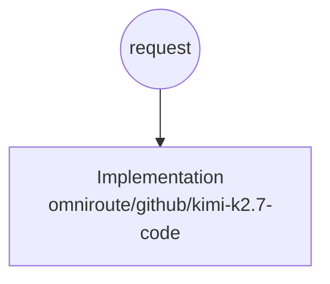
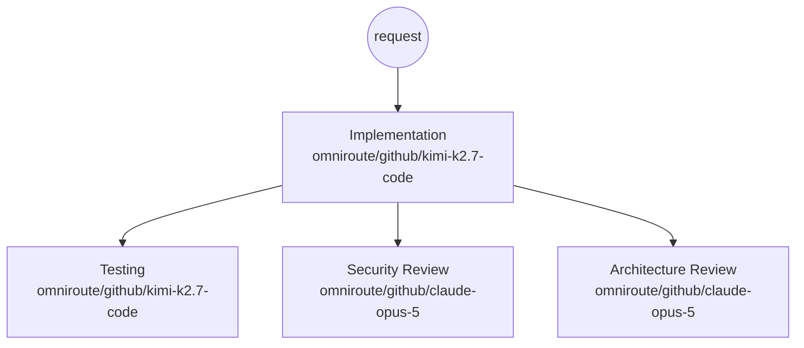
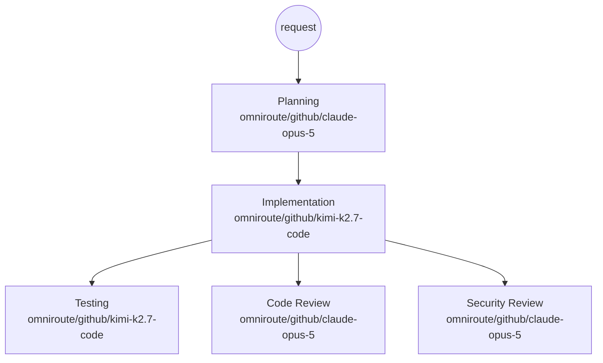
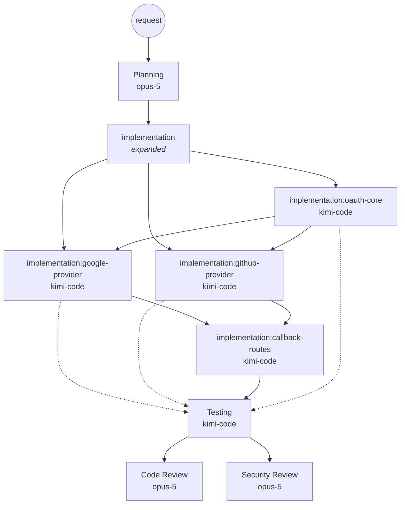
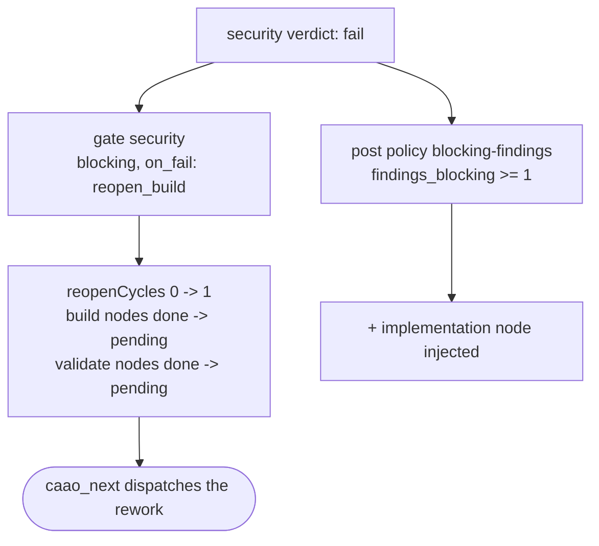
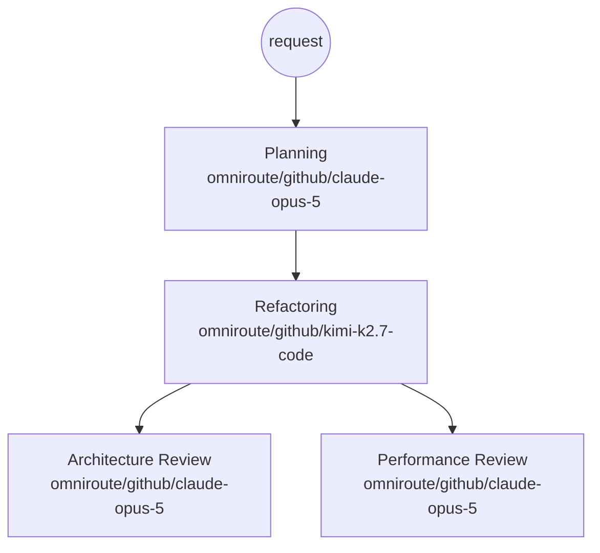
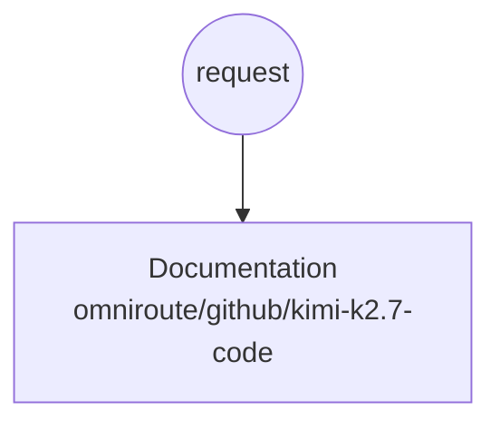
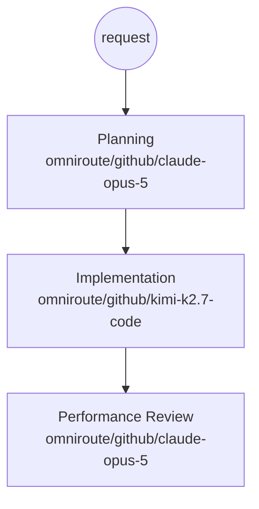

# 04 — Worked examples

All output below is **generated, not written by hand**. Reproduce it with:

```powershell
node tests/integration/examples.mjs
```

Each scenario is also asserted by the unit suite in [tests/caao.test.mjs](../tests/caao.test.mjs)
(suite: *policy engine — the six reference scenarios*), so the documentation cannot drift from the
behaviour.

---

## 1. Rename a variable

> `Rename the variable foo to userCount in src/report.ts` — 1 changed file

```
intent       : rename
complexity   : trivial
domains      : -
base         : trivial-change -> +implementation
capabilities : implementation
strategy     : direct (rule: direct, max_parallel: 1)
  node implementation   phase=build     model=omniroute/github/kimi-k2.7-code
```



**What to notice.** One capability, one worker, the cheapest and fastest pool, `direct` strategy — no
planning, no review, no merge machinery. The system spent nothing on orchestration because the request
did not warrant any. This is the requirement *"a trivial request must remain trivial"*, enforced by the
`direct` selection rule (`capability_count <= 1`), not by hoping the model behaves.

---

## 2. Fix failing tests

> `Fix the failing unit tests in the billing module` — `src/billing/invoice.ts`, `tests/billing.test.ts`

```
intent       : debug
complexity   : medium
domains      : payments, tests
base         : defect            -> +implementation, testing
augment      : touches-payments  -> +security, architecture
               (money-handling code requires security and structural review)
capabilities : implementation -> testing -> security -> architecture
strategy     : dag (rule: dag, max_parallel: 6)
  node implementation   phase=build     model=omniroute/github/kimi-k2.7-code
  node testing          phase=verify    model=omniroute/github/kimi-k2.7-code
  node security         phase=validate  model=omniroute/github/claude-opus-5
  node architecture     phase=validate  model=omniroute/github/claude-opus-5
waves        : 2 (1 -> 3 concurrent)
  wave 1: implementation
  wave 2: testing ‖ security ‖ architecture
```



**What to notice.** The request said nothing about security. The word *billing* matched the `payments`
domain, and `touches-payments` demanded a security and structural review. **Nobody wrote a "billing
bugfix pipeline"** — the topology was derived from context.

The whole run is **two waves**, not four. `testing`, `security` and `architecture` all read the same
build output and none reads the others', so `caao_next` returns all three at once and they execute
simultaneously — the reviews on the high-reasoning pool, the build and tests on the fast pool. The
critical path, not the node count, is what the run costs in wall-clock time.

---

## 3. Implement OAuth

> `Implement OAuth 2.0 authentication with Google and GitHub providers`

```
intent       : implement
complexity   : high
domains      : auth
base         : high-complexity            -> +planning, implementation, review
augment      : touches-auth               -> +security
               (authentication surface requires an adversarial review)
augment      : mutating-work-needs-proof  -> +testing
               (non-trivial implementations must be proven)
capabilities : planning -> implementation -> review -> security -> testing
strategy     : swarm (rule: swarm, max_parallel: 8)
  node planning         phase=plan      model=omniroute/github/claude-opus-5
  node implementation   phase=build     model=omniroute/github/kimi-k2.7-code (expandable)
  node testing          phase=verify    model=omniroute/github/kimi-k2.7-code
  node review           phase=validate  model=omniroute/github/claude-opus-5
  node security         phase=validate  model=omniroute/github/claude-opus-5
waves        : 3 (1 -> 1 -> 3 concurrent)
  wave 1: planning
  wave 2: implementation
  wave 3: testing ‖ review ‖ security
```



Five capabilities → the `swarm` rule fires (`capability_count >= 5`), so `max_parallel` becomes 8 and the
implementation node is marked **expandable**. After the planning worker returns its subtasks, the
Execution Manager calls `caao_expand`:

```jsonc
caao_expand(runId, "implementation", [
  { "id": "oauth-core",       "title": "OAuth 2.0 core: authorization code + PKCE flow" },
  { "id": "google-provider",  "title": "Google provider adapter",  "depends_on": ["oauth-core"] },
  { "id": "github-provider",  "title": "GitHub provider adapter",  "depends_on": ["oauth-core"] },
  { "id": "callback-routes",  "title": "Callback routes and session issuance", "depends_on": ["google-provider", "github-provider"] }
])
```

The graph becomes:



`google-provider` and `github-provider` are genuinely independent and execute at the same time. The
downstream `testing` node, which originally depended on `implementation`, was **automatically rewired**
to depend on all four children. The graph shape is a runtime consequence of the plan.

### Failure path

Suppose the security worker returns `verdict: "fail"` with two blocking findings:

```jsonc
caao_record(runId, "security", { status: "ok", verdict: "fail", findings_blocking: 2, confidence: 0.91 })
```



The loop closes automatically, bounded by `max_reopen_cycles: 2`. Exceeding it injects the `advisor`
instead of looping forever.

---

## 4. Refactor a monolith

> `Refactor the monolith into modular services`

```
intent       : refactor
complexity   : critical
domains      : -
base         : large-refactor -> +planning, refactoring, architecture, performance
capabilities : planning -> refactoring -> architecture -> performance
strategy     : swarm (rule: swarm, max_parallel: 8)
  node planning         phase=plan      model=omniroute/github/claude-opus-5
  node refactoring      phase=build     model=omniroute/github/kimi-k2.7-code (expandable)
  node architecture     phase=validate  model=omniroute/github/claude-opus-5
  node performance      phase=validate  model=omniroute/github/claude-opus-5
```



**What to notice.** `monolith` triggers `critical` complexity, which selects `large-refactor` *before* the
generic `refactor` rule (ordering matters — first match wins). `swarm` fires on complexity alone, even
though only four capabilities were selected: the refactoring node can fan out to dozens of module-level
workers, bounded by `expand_limit: 40`.

`architecture` is a **blocking gate with `on_fail: escalate`** — a structurally wrong decomposition does
not get auto-retried, it goes to the advisor. Some failures are judgement calls, not transient errors.

---

## 5. Generate API documentation

> `Generate API documentation for the public REST endpoints` — `src/api/routes.ts`

```
intent       : document
complexity   : medium
domains      : public_api
base         : doc-only -> +documentation
capabilities : documentation
strategy     : direct (rule: direct, max_parallel: 1)
  node documentation    phase=deliver   model=omniroute/github/kimi-k2.7-code
```



**What to notice.** The `public_api` domain *was* detected, but the `public-contract` augment policy adds
`documentation` — which the base rule already selected. Additive composition is idempotent: no duplicate
node, no wasted worker.

`doc-only` fires before the complexity rules, so a documentation request never drags in implementation
or review.

---

## 6. Optimize SQL queries

> `Optimize the slow SQL queries in the reporting database` — `src/db/reports.sql`

```
intent       : optimize
complexity   : medium
domains      : database
base         : optimization -> +planning, implementation, performance
capabilities : planning -> implementation -> performance
strategy     : dag (rule: dag, max_parallel: 6)
  node planning         phase=plan      model=omniroute/github/claude-opus-5
  node implementation   phase=build     model=omniroute/github/kimi-k2.7-code (expandable)
  node performance      phase=validate  model=omniroute/github/claude-opus-5
waves        : 3 (1 -> 1 -> 1 concurrent)
```



**What to notice.** `performance` is the only non-blocking gate (`on_fail: annotate`). A query that got
faster but not fast enough is reported as a finding, not treated as a failure — the result is still
delivered, with the caveat attached.

The planning node exists because optimisation without measurement is guesswork: it identifies *which*
queries to attack before any worker rewrites SQL.

---

## 7. The same request, understood two ways

This is the point of the semantic layer. One vague request — *"Sort out the thing with the reports"* —
classified twice, differing **only** in the confidence the triage worker reported.

### 7a. Understood — confidence 0.88

```
understanding: confident (confidence 0.88)
intent       : optimize
complexity   : medium
domains      : database
base         : optimization        -> +planning, implementation, performance  (baseline capability set)
capabilities : planning -> implementation -> performance
strategy     : dag
  node planning         model=omniroute/github/claude-opus-5   tier=heavy
  node implementation   model=omniroute/github/kimi-k2.7-code  tier=standard
  node performance      model=omniroute/github/claude-opus-5   tier=heavy
```

The build step runs on the **fast** model. The system understood the request, so there is nothing to
insure against.

### 7b. Not understood — confidence 0.35

```
understanding: guessed (confidence 0.35)
intent       : implement          <- the semantic verdict was DISCARDED
complexity   : high               <- raised one step by the `guessed` band
domains      : -
base         : high-complexity            -> +planning, implementation, review
augment      : mutating-work-needs-proof  -> +testing
capabilities : planning -> implementation -> review -> testing
strategy     : dag
  node planning         model=omniroute/github/claude-opus-5   tier=heavy
  node implementation   model=omniroute/github/claude-opus-5   tier=heavy
       ⬆ escalated: the request was not understood confidently — do not let a fast model guess
  node testing          model=omniroute/github/kimi-k2.7-code  tier=standard
  node review           model=omniroute/github/claude-opus-5   tier=heavy
```

Three things happened automatically, and all three are declared in YAML, not coded:

1. The low-confidence band **raised the complexity**, which pulled in `planning` and `review`.
2. `unclear-request` and `understanding-collapsed` reinforced the same conclusion from `policies.yaml`.
3. The `implementation` binding's first override matched `understanding: [uncertain, guessed]` and
   **moved the build step to a heavy model**, carrying its reason into the recap.

Uncertainty buys scrutiny. Confidence buys speed. You control the exchange rate by moving one number
in `classification.semantic.bands`.

---

## 8. The attribution recap

After the OAuth run of scenario 3 completes, `caao_report` returns exactly this — and the Execution
Manager is required to print it:

```
request      : Implement OAuth 2.0 authentication with Google and GitHub providers
understanding: confident
```

| Phase | Capability | Model | Attempts | Confidence | Time |
| --- | --- | --- | --- | --- | --- |
| plan | Planning | `omniroute/github/claude-opus-5` | 1 | 0.94 | 2ms |
| build | Implementation | `omniroute/github/kimi-k2.7-code` | 1 | 0.86 | 2ms |
| verify | Testing | `omniroute/github/kimi-k2.7-code` | 1 | 0.91 | 2ms |
| validate | Code Review | `omniroute/github/claude-opus-5` | 1 | 0.90 | 2ms |
| validate | Security Review | `omniroute/github/claude-opus-5` | 1 | 0.93 | 4ms |

```
by model:
  omniroute/github/claude-opus-5     tier=heavy     steps=3  planning, review, security
  omniroute/github/kimi-k2.7-code    tier=standard  steps=2  implementation, testing

parallelism  : 3 waves, widest 3 concurrent (1 -> 1 -> 3), budget 8
```

Read it as: *plan by Opus, code by Kimi, review by Opus, security by Opus.* If a step had been retried
on a different model, the row would show `attempts: 2` and the recap would list it under `escalations`
with `switchedFrom` and the verbatim reason.

The `parallelism` line is the honesty check on the orchestration: five nodes executed in three waves,
so the critical path is three model calls long, not five. The full block also carries `modelTimeMs`
(the time the models actually spent working), `wallClockMs` (the time you waited) and the resulting
`speedup`. A speed-up near 1 on a multi-node run means something serialised the graph and is worth
investigating.

## 9. Proving the parallelism end-to-end

Wide graphs on paper are worthless if the Execution Manager dispatches them one at a time.
`npm run test:e2e` runs the billing scenario against a scripted provider that delays every worker reply
and counts how many are in flight simultaneously:

```
e2e: ok — 19 model calls, waves 1 -> 3, peak 3 workers in flight,
     tools used: caao_triage, task, caao_plan, caao_next, caao_record, caao_merge, caao_report
```

`peak 3 workers in flight` is measured inside the provider, not asserted by the engine — it is proof
that opencode really executed three subagents at the same time. The test fails if that number drops.

Regenerate everything on this page with:

```powershell
node tests/integration/examples.mjs
```

---

## Comparative summary

| Scenario | intent | complexity | capabilities | strategy | workers |
| --- | --- | --- | --- | --- | --- |
| Rename variable | rename | trivial | 1 | `direct` | 1 |
| Fix failing tests | debug | medium | 4 | `dag` | 4 |
| Implement OAuth | implement | high | 5 | `swarm` | 5 → 8 after expansion |
| Refactor monolith | refactor | critical | 4 | `swarm` | 4 → *n* after expansion |
| Generate API docs | document | medium | 1 | `direct` | 1 |
| Optimize SQL | optimize | medium | 3 | `dag` | 3 → *n* after expansion |
| Vague request, understood | optimize | medium | 3 | `dag` | 3, build on the fast model |
| Vague request, guessed | implement | high | 4 | `dag` | 4, build **escalated** to the heavy model |

Eight requests, eight different topologies, **zero hardcoded pipelines**. Every difference comes from
`policies.yaml`, `providers.yaml` and `workflows.yaml`.

---

## Provider independence, demonstrated

`npm run test:e2e` proves the WHO/WHAT separation concretely. It swaps `providers.yaml` so every one of
the 15 bindings points at a mock pool, runs `npm run caao:sync`, and executes a real `opencode run`:

```yaml
pools:
  mock:
    tier: standard
    model: caao-mock/mock-1
    traits: { reasoning: 5, quality: 5, speed: 5, cost: 1 }
bindings:
  documentation: { strategy: declared, candidates: [mock] }
  # …every capability, generated from the registry so it can never drift
```

Result:

```
e2e: ok — 12 model calls, tools used: caao_triage, task, caao_plan, caao_next,
                                      caao_record, caao_merge, caao_report
```

The entire fleet moved to a different model with **one file changed**. No capability, policy or workflow
was touched. That is the whole point.

---

Next: [05 — Operations](05-operations.md)
