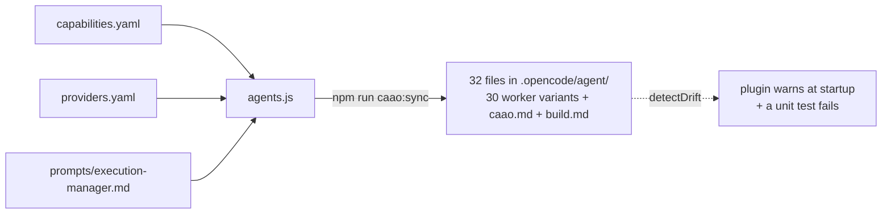
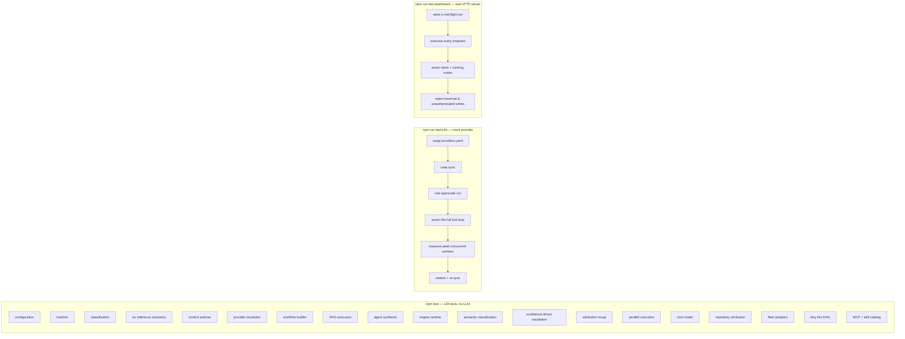

# 05 — Operations

Install, run, extend, test, troubleshoot.

---

## 1. Prerequisites

| Component | Version used | Notes |
| --- | --- | --- |
| opencode | 1.18.15 | Standalone binary, embeds Bun. |
| Node.js | 24.x | Only needed for `npm test` and `npm run caao:sync`. |
| An OpenAI-compatible gateway | – | Here: `omniroute` at `http://localhost:20128/v1`. |

Installed on Windows without administrator rights:

```
%LOCALAPPDATA%\Programs\opencode\opencode.exe
%LOCALAPPDATA%\Programs\node-v24.19.0-win-x64\node.exe
```

Both directories are on the **User** `PATH`. Verify:

```powershell
opencode --version    # 1.18.15
node --version        # v24.19.0
```

The gateway credential is local to each machine and is never committed or distributed. Set it through
the environment your shell, MDM profile or CI runner uses:

```powershell
$env:OMNIROUTE_API_KEY = "…"
```

---

## 2. First run

```powershell
cd .opencode
npm install           # @opencode-ai/plugin, yaml
cd ..
npm run caao:sync     # caao: regenerated 16/16 agents
opencode
```

The plugin is auto-loaded from `.opencode/plugin/` — no `plugin: []` entry is required in
`opencode.json`.

### Entry points

| Command | Effect |
| --- | --- |
| `opencode` | Starts on the CAAO Execution Manager (the generated `build.md` overrides opencode's default primary agent). |
| `opencode run --agent caao --auto "…"` | Headless single-shot orchestration. |
| `opencode run --agent caao-review "…"` | Bypass orchestration, use one capability directly. |

To restore stock opencode behaviour, delete `.opencode/agent/build.md` and remove `build` from
`renderAgents()` in [.opencode/caao/agents.js](../.opencode/caao/agents.js).

---

## 3. Generated agents

`.opencode/agent/*.md` are **build artefacts**. Every one carries:

```
<!-- generated by caao:sync — edit capabilities.yaml / providers.yaml instead -->
```



### One agent per capability × pool

A capability is generated **once per pool it can reach** — the union of its `candidates` and every pool
referenced by its `overrides` or their profiles (`poolsFor()`):

| File | Model |
| --- | --- |
| `caao-implementation.md` | `kimi-k2.7-code` (the default binding) |
| `caao-implementation--opus-5.md` | `claude-opus-5` (used when an override fires) |

The default pool gets the bare name; alternates get `caao-<capability>--<pool>`. This is not cosmetic:
opencode binds a model per **agent file**, so runtime escalation is only real if the escalated model has
an agent of its own. `caao_next` returns the agent name to use, and the Execution Manager is forbidden
from substituting another one.

Editing them by hand is pointless: the next `caao:sync` overwrites the file, a unit test fails, and the
plugin prints a warning at startup.

### Why files and not a plugin?

opencode honours per-agent `tools` restrictions **only** when they come from an agent definition on disk
or from `opencode.json`. Restrictions injected from a plugin's `config()` hook are silently discarded —
verified empirically:

```
# tools set to false by the plugin  -> ignored
opencode debug agent caao-security   # edit=True  write=True  task=True  caao_*=True

# same tools declared in the agent file -> honoured
opencode debug agent caao-security   # edit=False write=False task=False caao_*=False
```

`model`, `prompt`, `description`, `temperature` and `mode` *do* apply from a plugin. Tool isolation is the
security-relevant part, so agents are generated files.

### Anatomy of a generated worker

```yaml
---
description: Security Review — Detect exploitable weaknesses introduced or exposed by the change.
mode: subagent
model: omniroute/github/claude-opus-5      # from providers.yaml binding
temperature: 0.1                           # from the pool
tools:
  caao_context: false   # …all 10 orchestration tools disabled
  task: false           # cannot spawn other workers
  write: false          # follows capabilities.yaml `mutates`
  edit: false
  patch: false
---
```

---

## 4. Common changes

### Swap a model across the whole fleet

Edit one block in [providers.yaml](../.opencode/providers.yaml):

```yaml
pools:
  opus-5:
    model: omniroute/github/claude-opus-5    # <- change this line
```

```powershell
npm run caao:sync
```

Nothing else moves. No capability, policy or workflow file is touched.

### Add a model tier

```yaml
pools:
  nano:
    tier: standard
    model: omniroute/github/some-small-model
    traits: { reasoning: 2, quality: 2, speed: 5, cost: 1 }
    temperature: 0.2

bindings:
  documentation:
    strategy: cheapest
    candidates: [nano, kimi-code, opus-5]
```

`nano` wins, and `kimi-code` → `opus-5` become the retry fallback chain automatically.

### Add a second (or third) heavy model

This is the supported way to have several heavy models rather than one.

1. Declare the model in `opencode.json` so opencode can reach it.
2. Add the pool in `providers.yaml` with `tier: heavy` and honest traits:

   ```yaml
   pools:
     gpt-5:
       tier: heavy
       model: omniroute/github/gpt-5
       traits: { reasoning: 5, quality: 5, speed: 3, cost: 4 }
       temperature: 0.1
   ```

3. Add it to the `heavy` profile:

   ```yaml
   profiles:
     heavy: { strategy: highest_reasoning, candidates: [opus-5, gpt-5, kimi-code] }
   ```

4. `npm run caao:sync`.

Every capability that can escalate now gains a `caao-<capability>--gpt-5.md` variant, and the profile's
ranking strategy decides which heavy model wins. Change `strategy` to `cheapest` and escalations become
budget-aware without a line of code.

### Route a specific situation to a heavy model

```yaml
bindings:
  implementation:
    strategy: balanced
    candidates: [kimi-code, opus-5]
    overrides:
      - when: { touches: [crypto] }
        profile: heavy
        reason: cryptographic code is not a place to save money
```

The first matching override wins. `when` accepts the full condition language, so
`{ all: { complexity: [high, critical], touches: [payments] } }` is valid. The `reason` is printed in
the recap, so an expensive run always justifies itself.

### Tune how eagerly the system escalates

The single most powerful knob is the confidence band table in `policies.yaml`:

```yaml
classification:
  semantic:
    bands:
      - { id: confident, min: 0.80, adopt: semantic }        # raise 0.80 -> stricter, more escalation
      - { id: probable,  min: 0.60, adopt: conservative }
      - { id: uncertain, min: 0.40, adopt: conservative, raise_complexity: 1 }
      - { id: guessed,   min: 0.00, adopt: keywords,     raise_complexity: 1 }
```

* **Raise the thresholds** → fewer requests count as understood → more planning, more review, more heavy
  model usage. Safer and slower.
* **Lower them** → more requests go straight to the fast model. Cheaper and more optimistic.
* **`enabled: false`** → disable the semantic layer entirely and fall back to keywords.

Verify the effect without spending a token:

```powershell
node tests/integration/examples.mjs
```

### Add a capability

1. Declare it in `capabilities.yaml` (phase, context, `mutates`, `confidence_floor`, `worker` block).
2. Add a binding in `providers.yaml` — **mandatory**, startup validation enforces it.
3. Reference it from a `base` or `augment` policy.
4. Optionally add a gate in `workflows.yaml` under `validation.gates`.
5. `npm run caao:sync` — a new `caao-<id>.md` appears (plus one variant per reachable pool).

### Add a policy

```yaml
augment:
  - id: touches-frontend
    when: { touches: [frontend] }
    capabilities: [review]
    reason: UI changes need an accessibility-aware review
```

No code change. Add a unit test asserting the resolved capability set, and you are done.

### Change how aggressive orchestration is

```yaml
selection:
  - id: direct
    when: { capability_count: { lte: 2 } }   # was 1 — more requests stay single-worker
```

### Make runs faster, or safer

Two independent levers, both in `workflows.yaml`. Reach for the first one; the second rarely helps.

**1. The shape of the graph — `execution.phase_depends_on`.** This decides how many workers *can* run
together. Widen it by removing a dependency, tighten it by adding one:

```yaml
phase_depends_on:
  validate: [build]           # reviews start as soon as the build lands (default)
  # validate: [build, verify] # reviews wait for green tests — slower, but no review of broken code
```

**2. The budget — `strategies.<id>.max_parallel`.** This caps how many of those workers are dispatched
at once. Raising it past the width of your graph does nothing; lower it if your gateway rate-limits.

Check what actually changed before spending a token:

```powershell
node tests/integration/examples.mjs   # prints the wave structure of all six scenarios
```

and after a real run, read `parallelism` in `caao_report`: `waves` is the critical path, `widest` is the
peak concurrency, `speedup` is model time over wall-clock time. If `speedup` is ~1 on a multi-node run,
the Execution Manager serialised a wave — a prompt problem, not a configuration problem.

---

## 5. Testing



```powershell
npm test              # tests 134 · pass 134 · fail 0
npm run test:e2e
npm run test:dashboard
npm run test:all      # all three
node tests/integration/examples.mjs   # regenerate the docs examples
```

### What the unit suite locks down

| Suite | Guarantees |
| --- | --- |
| configuration | All four registries load and cross-validate; a broken fixture throws. |
| matcher | Word boundaries, multi-word phrases, glob matching, numeric operators. |
| classification | Intent, complexity and domain detection, including path-based domains. |
| six reference scenarios | The exact capability set and strategy for each paper example. |
| context policies | `touches-auth`, `touches-payments`, `wide-change`, `migration-safety`, the augment fixpoint. |
| provider resolution | Trait ranking per strategy, fallback chains, `attempt`-based provider switching. |
| workflow builder | `direct`/`dag`/`swarm` selection, phase layering, barrier nodes, `expandable` marking. |
| DAG execution | Fan-out, dependency rewiring, `expand_limit`, ready-node computation. |
| agent synthesis | Tool matrix per capability, model binding, **and zero drift** between YAML and generated files. |
| engine runtime | Retry ladder, advisor injection, gate reopen, merge conflicts, capability chaining, run log. |
| semantic classification | Verdict parsing, every confidence band, domain union, disagreement handling, and that a run with **no** triage input reproduces the pre-semantic behaviour exactly. |
| confidence-driven escalation | Overrides on `understanding`, `complexity` and `touches`; first-match-wins; fallback chain after escalation; `poolsFor`. |
| attribution recap | Per-step model, grouping by model, escalations with `switchedFrom`, the understanding block, and the markdown table. |
| parallel execution | Tests and reviews land in the **same** wave; reviews depend on the build, never on the tests beside them; `caao_next` hands out the whole wave at once; serial capabilities stay alone; reopening the build invalidates the entire downstream subgraph; a stale in-flight result is discarded; a backwards `phase_depends_on` is rejected at load time. |
| cost model | Per-million billing, the cached-input multiplier, unpriced pools billing zero, drift-free summation, usage parsed from either casing, budget thresholds, and cost attributed per node across retries. |
| repository attribution | `repoSlug` normalises ssh/https/`.git`/bare remotes to one bucket; repo, branch and actor persist on the run and reach the recap. |
| fleet analytics | Run summarisation, grouping by repo/model/capability/actor, repository-scoped filtering, a gap-free daily series, and tolerance of legacy run files with none of the new fields. |
| why this DAG | The causal chain is contiguous and ordered; every policy step names its rule and declared reason; the topology step cites `workflows.yaml`; every task has a model and a reason for it; counterfactuals are produced. |
| MCP + skill catalog | Scope matching by repository and team, per-machine manifests with reasoned exclusions, an opencode-shaped mcp block that keeps secrets as `{env:NAME}` references, and rejection of half-declared entries. |

Two structural assertions are worth calling out:

* `capabilities.yaml` and `policies.yaml` must not contain any model identifier or the string
  `omniroute` — the separation is enforced by a test, not by convention.
* `detectDrift(config)` must return an empty list — generated agents can never silently diverge from the
  registries.

### The end-to-end test

[tests/integration/e2e.mjs](../tests/integration/e2e.mjs) + [mock-provider.mjs](../tests/integration/mock-provider.mjs):

1. Back up `providers.yaml` and `opencode.json`.
2. Point **every** binding at a mock pool — the list is generated from the capability registry, so it
   cannot drift when a capability is added — and inject a `caao-mock` provider.
3. `npm run caao:sync`, assert `caao-security.md` now reads `model: caao-mock/mock-1`.
4. Start a scripted OpenAI-compatible SSE server that plays the Execution Manager, the triage worker and
   the capability workers. Worker replies are **delayed by 250 ms** and the server counts how many are
   in flight at the same time.
5. Run `opencode run --agent caao --auto "Fix the failing unit tests in the billing module"` — a request
   that produces a 3-wide wave (`testing ‖ security ‖ architecture`).
6. Assert the loop actually happened: `caao_triage` → `task` → `caao_plan` → `caao_next` → `task` →
   `caao_record` → `caao_merge` → `caao_report`, every worker was invoked, and the final answer arrived.
7. Assert **`peakWorkers >= 3`**. This is the only place concurrency is *measured* rather than asserted:
   if the Execution Manager ever starts dispatching a wave one worker at a time, the peak drops to 1 and
   the test fails.
8. Restore everything and re-sync in a `finally` block.

```
e2e: ok — 19 model calls, waves 1 -> 3, peak 3 workers in flight,
     tools used: caao_triage, task, caao_plan, caao_next, caao_record, caao_merge, caao_report
```

### The dashboard test

[tests/integration/dashboard.mjs](../tests/integration/dashboard.mjs) boots the real server on an
ephemeral port against real run files. It seeds a run, completes one wave and leaves the next in
flight, then requires the graph endpoint to report **both** a completed node with a model **and** a
running node — proving the console can genuinely show work in progress rather than only finished
history. It then asserts the access model: every console endpoint refuses anonymous and wrong-token
callers without leaking data, sign-in issues an `HttpOnly; SameSite=Strict` session, a cookie alone
cannot mutate state, three path-traversal encodings cannot escape `dashboard/`, and a
`dist`-role server answers **404** for `/`, `/app.js` and every `/api/*` path. Finally it runs a
signed bundle over real HTTP — build, sign, serve, fetch, verify, apply — and proves that tampered,
unsigned and wrongly-keyed bundles are all refused.

---

## 5b. Running the two servers

The same executable serves two different audiences and must not serve both to the same people.

```powershell
# developer-facing: signed configuration only. No run data on this surface at all.
$env:CAAO_SIGNING_KEY = "C:\caao-keys\caao-signing.key"
$env:CAAO_DIST_TOKEN  = "…"                 # optional shared secret
$env:CAAO_DIST_CHANNELS = '{"stable":"/srv/caao","canary":"/srv/caao-canary"}'
npm run caao:dist

# admin-facing: the console. Refuses to start without a token.
$env:CAAO_ADMIN_TOKEN     = "…"
$env:CAAO_DASHBOARD_PORT  = "20200"          # optional
npm run caao:dashboard                       # http://127.0.0.1:20129

node .opencode/caao/seed-demo.mjs          # populate it without a live provider
node .opencode/caao/seed-demo.mjs --clean  # remove exactly what was seeded
```

The console binds `127.0.0.1` and warns loudly if `CAAO_DASHBOARD_HOST` moves it. Share it only
through an SSO reverse proxy restricted to an admin group; the token is then a second factor, not
the only one. A `dist` server can be reached by every laptop in the company — it never opens a run
file, and it answers 404 for every console route so nobody learns the console exists.

Full reference: [docs/06-dashboard.md](06-dashboard.md) and
[docs/07-distribution.md](07-distribution.md).

---

## 6. Inspecting a run

```powershell
opencode debug config              # providers + all 32 agents
opencode debug agent caao          # Execution Manager tool matrix
opencode debug agent caao-testing  # worker tool matrix
opencode debug startup             # plugin load time, plugin errors
```

Runs are persisted as JSON:

```
.opencode/state/runs/run-20250612T101500Z-a4f1.json
```

Ask the Execution Manager for `caao_status` with no `runId` to list the 10 most recent runs, or with a
`runId` for the full state and a live mermaid graph. `state/` is git-ignored.

---

## 7. Troubleshooting

| Symptom | Cause | Fix |
| --- | --- | --- |
| `CAAO configuration is invalid: …` at startup | A registry cross-reference is broken. | The message names the exact rule — usually a capability with no provider binding. |
| `caao: N agent definition(s) are stale` | YAML changed after the last sync. | `npm run caao:sync` |
| A worker can edit files but should not | Capability `mutates` is wrong, or the agent file is stale. | Fix `capabilities.yaml`, re-sync, verify with `opencode debug agent`. |
| Agent `tools` restrictions have no effect | Set from a plugin instead of an agent file. | Declare them in the generated agent file (see §3). |
| `Unexpected token '\uFEFF' … is not valid JSON` | `opencode.json` was written with a UTF-8 BOM. | Rewrite without a BOM; avoid PowerShell `Set-Content -Encoding utf8`. |
| `Cannot find module 'C:\…\tests'` | `node --test <dir>` is unsupported on Node 24. | Use a glob: `node --test "tests/*.test.mjs"`. |
| Everything is serialised, nothing runs in parallel | The Execution Manager dispatched `caao_next` results one at a time. | The doctrine in `prompts/execution-manager.md` requires parallel `task` calls in a single turn. |
| Run stuck at `needs_human` | `collapsed-confidence` or an advisor `escalate_human`. | `caao_status` shows the node, the reason and the attempt history. |
| Model calls fail / time out | The gateway is down. | The engine is LLM-free — `npm test` still passes and proves the orchestration is intact. |
| Everything escalates to the heavy model | The triage worker reports low confidence, or the bands are too strict. | `caao_report` names the reason. Lower the `min` values in `classification.semantic.bands`, or improve the triage prompt. |
| Nothing ever escalates | No triage verdict is reaching `caao_plan` — `understanding` stays `keywords-only`. | Check that the Execution Manager calls `caao_triage` first and passes the worker's raw reply as `triage`. |
| The recap shows a model you did not expect | An override fired. | The `escalationReason` in `caao_report` is the verbatim `reason` from `providers.yaml`. |
| Every run costs $0.00 in the console | The runtime reports no usage and nothing observed it. | The plugin bills from opencode's `message.updated` events; check it loaded (`caao_status` shows a run) and that the provider returns a usage block. |
| An MCP server is declared but never starts | It is missing from `opencode.json`, its binary is not installed, or its token is unset. | `npm run caao:doctor` names the reason and the install command; `npm run caao:catalog` writes the missing `mcp` block. |
| A context tool shows no savings | It reported none. | CAAO never estimates. Declare the metadata keys or the output `pattern` under `savings:` in `catalog.yaml`; until then the calls count as *unreported*. |

---

## 8. Repository layout

```
.
├── README.md
├── package.json                    test · test:e2e · caao:sync · caao:catalog · caao:doctor
├── docs/
│   ├── 01-architecture.md
│   ├── 02-configuration.md
│   ├── 03-tools.md
│   ├── 04-examples.md
│   ├── 05-operations.md
│   ├── 06-dashboard.md
│   ├── 07-distribution.md
│   └── 08-mappa-dei-file.md        in italiano — file by file, with a worked example
├── dashboard/                      the console UI — outside .opencode on purpose
│   ├── index.html
│   ├── app.js
│   └── styles.css
├── tests/
│   ├── caao.test.mjs               163 unit tests
│   ├── fixtures/broken/            invalid registries
│   └── integration/
│       ├── mock-provider.mjs       scripted OpenAI-compatible SSE server
│       ├── e2e.mjs                 full-loop test
│       ├── dashboard.mjs           API surface + auth
│       └── examples.mjs            regenerates docs/04
└── .opencode/
    ├── opencode.json               opencode runtime config (providers, credentials)
    ├── AGENTS.md                   project doctrine
    ├── capabilities.yaml           WHAT
    ├── providers.yaml              WHO
    ├── policies.yaml               WHEN
    ├── workflows.yaml              HOW
    ├── catalog.yaml                central MCP servers, skills and context tools
    ├── package.json
    ├── prompts/
    │   └── execution-manager.md
    ├── caao/                       the engine
    │   ├── match.js                condition mini-language
    │   ├── config.js               load + cross-validate
    │   ├── classify.js             keyword prior · triage parsing · band fusion
    │   ├── policy.js               base → augment fixpoint, post, strategy
    │   ├── provider.js             trait ranking, overrides, profiles, fallback chains
    │   ├── dag.js                  graph build, expansion, mermaid
    │   ├── context.js              git signals
    │   ├── state.js                run persistence
    │   ├── usage.js                opencode events → billable tokens, attributed
    │   ├── savings.js              context-tool output → tokens saved
    │   ├── pricing.js              tokens → money
    │   ├── analytics.js            aggregation for the console
    │   ├── rationale.js            why this DAG
    │   ├── catalog.js              MCP + skill catalog and per-machine manifest
    │   ├── doctor.js               can each declared tool actually start here?
    │   ├── distribution.js         signed bundles and channels
    │   ├── engine.js               triageBrief · plan · next · expand · record · merge · status · report
    │   ├── agents.js               agent rendering (capability × pool) + drift detection
    │   ├── server.mjs              the console API
    │   └── sync.mjs · catalog.mjs · doctor.mjs   CLIs
    ├── plugin/
    │   └── caao.js                 12 caao_* tools + passive usage and savings metering
    ├── agent/                      GENERATED — 32 files
    └── state/runs/                 git-ignored
```

---

## 9. Design invariants

Break any of these and the model stops being CAAO:

1. A capability never names a model.
2. A policy never names a model, an agent, or a topology.
3. A worker never knows another worker exists.
4. The Execution Manager never edits files.
5. Validation capabilities never mutate.
6. Every orchestration decision is computed by the engine and recorded with the rule that caused it.
7. Trivial requests stay trivial.
8. How much the system spends is a function of how well it understood the request, and that function is
   declared in YAML, not coded.
9. Every completed run can say which model performed which step, and why.

Invariants 1, 3, 4, 5 and 9 are enforced by tests. The rest are enforced by the architecture.

---

Back to the [README](../README.md).
