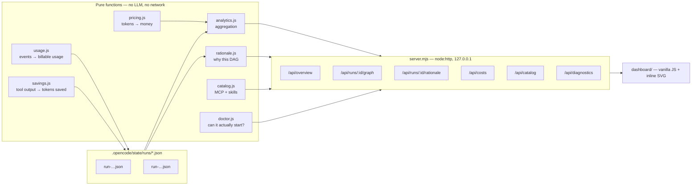

# 06 — The enterprise console

> Company-wide visibility over an orchestration system that many developers use at once:
> what is running, what it costs, on which repository, on which model, and **why that plan**.

```powershell
$env:CAAO_ADMIN_TOKEN = "…"
npm run caao:dashboard          # http://127.0.0.1:20129

npm run caao:dashboard:dev      # same console, fixed token `caao-dev`, loopback only
```

Zero dependencies. `node:http` plus a vanilla-JS single page — no framework, no build step, no
bundler, nothing to keep patched beyond Node itself.

---

## 1. What problem it solves

A single developer can read a `caao_report` recap in their terminal. A hundred developers cannot: the
information a platform owner needs is *aggregate* and *cross-repository*.

| Question | Where the console answers it |
| --- | --- |
| How much are we spending this month, and against which budget? | Overview · Costs |
| Which repository is burning the budget? | Repositories |
| Which model, and which *capability*, is expensive? | Costs → by model / by capability |
| What is running right now? | Overview → In flight |
| Which task is on which model, right now? | Run drawer → Execution DAG |
| Why did this one sentence produce **that** graph? | Run drawer → Why this DAG |
| Which MCP servers and skills does each developer get? | MCP & skills |

---

## 2. Architecture



The engine writes run files during execution; the console only reads them. Turning the dashboard off
changes nothing about how CAAO behaves — it is a window, not a component.

---

## 3. The cost model

### 3.1 Two different numbers, deliberately separated

CAAO has always ranked candidate models with an **abstract** `traits.cost` score from 1 to 5. That
score is for *routing*: "prefer the cheaper one when quality is not the constraint".

Money is a different concern. A per-pool `pricing` block was added for *billing*:

```yaml
pools:
  opus-5:
    model: omniroute/github/claude-opus-5
    tier: heavy
    traits: { cost: 5, reasoning: 5, speed: 2 }   # ← used by the router
    pricing:                                       # ← used by the ledger
      input_per_mtok: 15.00
      output_per_mtok: 75.00
```

> **The router never reads `pricing`.**
> If dollars fed back into routing, a price change would silently rewire the company's engineering
> quality. Prices change weekly; the intent "this is our reasoning model" does not.

Cached input is billed at `cached_multiplier` (default `0.1`) of the input rate.
A pool with no `pricing` block simply bills zero and is shown as *unpriced*.

### 3.2 Where the numbers come from

Primarily from opencode itself. Every assistant message carries the provider's usage report, and the
plugin turns each completed one into a billable observation:

```jsonc
// opencode event -> engine.ingestUsage()
{
  agent: "caao-implementation--opus-5",
  model: "omniroute/github/claude-opus-5",
  usage: { inputTokens: 12400, outputTokens: 3100, cachedTokens: 900, totalTokens: 15500 }
}
```

This matters because **a worker cannot report its own token counts — it never sees them**. Asking a
model to state them produced exactly what you would expect: zeros, and a console that billed every
run at $0.00. Cache reads are folded into a single input figure and the cached share is kept
separately, so a run that benefits from prompt caching is visibly cheaper rather than merely smaller.

Attribution follows three rules, in order:

1. **Agent name.** `caao-implementation--opus-5` was dispatched for exactly one capability.
2. **Identical workers in parallel.** No signal can tell a planning fan-out apart, so the
   least-billed node takes the message. Across the wave the total is exact; per node it is a fair split.
3. **Late arrival.** A worker's final message can land after the Execution Manager recorded the
   result; within two minutes it still belongs to that task.

When the answering agent is the orchestrator itself, the tokens belong to **no task** and land in the
run's `orchestrator` bucket. Planning, dispatching and merging is real money, and hiding it would
make every run look cheaper than it is.

`caao_record` may still carry `tokens_in` / `tokens_out` / `tokens_cached` for a runtime that reports
nothing. Reported and observed usage are never double-counted: a recorded figure is added only when
the event stream produced none.

If neither source produced a number the run is marked *unmetered* and shows `—` rather than a
fabricated zero. Missing data is displayed as missing data.

### 3.3 Tokens saved by context tools

Compression and retrieval MCPs — `headroom`, `caveman` — only justify their complexity if they pay
for themselves. CAAO never sees the payload they compressed, so it does not estimate a ratio. It
reads the numbers **the tool itself publishes**, from the metadata keys or the output pattern
declared next to the entry in `catalog.yaml`:

```yaml
  - id: headroom
    savings:
      tools: [headroom_compress, headroom_stats]
      metadata:
        before: [original_tokens, tokens_before]
        after: [compressed_tokens, tokens_after]
        saved: [tokens_saved]
      pattern: "saved\\s+(?<saved>\\d+)\\s+tokens"
```

Saved input tokens are valued at the input price of the pool that would have read them. A call that
publishes nothing is counted as **unreported** and shown as such — never as a zero saving, and never
as an invented one.

### 3.4 Budgets

```yaml
budgets:
  monthly_total: 5000      # company-wide, USD
  per_repo_monthly: 800
  per_run: 5.00
  warn_at: 0.80            # amber at 80% of any limit
```

Budgets are **observational**. CAAO never refuses work because a budget is exhausted: an orchestrator
that silently degrades quality at month-end is worse than one that reports honestly. Each limit
produces a state — `ok`, `warn`, `over` — rendered as a bar in the console.

---

## 4. Repository segmentation

Every run records where it came from:

```jsonc
{
  "repo":   "acme/billing-service",   // owner/name from the git remote
  "project":"acme/billing-service",   // repo, or the folder name outside a repo
  "branch": "fix/billing-tests",
  "commit": "a1b2c3d",
  "actor":  "ann@acme.dev"            // CAAO_ACTOR, else git user.email, else the OS user
}
```

`repoSlug()` normalises every remote form — `git@github.com:acme/x.git`, `https://github.com/acme/x`,
with or without `.git` — to the same `acme/x` bucket, so a run is attributed identically no matter how
the developer cloned.

On CI or shared runners set `CAAO_ACTOR` to attribute the run to the human who triggered it rather
than to the build agent.

The repository selector in the sidebar re-scopes **every** figure on every screen, so a team lead can
look at their own repository without the rest of the company skewing the totals.

---

## 5. The live DAG

The run drawer draws the graph as inline SVG, laid out by the same `waves()` function the scheduler
uses. Columns are waves; everything in one column runs simultaneously.

| Colour | Meaning |
| --- | --- |
| green | done |
| blue, breathing | running right now |
| grey | pending — waiting for an upstream phase |
| red | failed |
| amber | reopened, invalidated by a blocking review |

Each box carries the task title, **the model executing it**, and either its confidence and duration
(done) or a live indicator (running). `⬆` marks a task escalated to a heavier model; hovering states
the declared reason. `⛔` marks a blocking reviewer.

The **Tasks & models** tab is the same information as a table: task, phase, wave, status, model,
attempts, confidence, time, cost.

The page polls every four seconds, so a graph opened while a run is executing fills in live.

---

## 6. Why this DAG

The most common question about an autonomous orchestrator is not *what* it did but *why it decided
to do that*. Because CAAO is deterministic and declarative, the answer is reconstructible — it is not
an LLM writing a plausible story after the fact.

`rationale.js` replays the causal chain:

```
step 1  understanding   The request was classified
                        · intent read as "implement", complexity "high"
                        · confidence 62% → understanding band "uncertain"
                        · the semantic and keyword readings disagreed, so confidence was lowered

step 2  policy:base     Baseline set chosen by rule `implementation-baseline`
step 3  policy:augment  Policy `security-surface` added Security Review
                        · reason as declared in policies.yaml: "the request touches authentication"
step 4  policy:augment  Policy `uncertain-understanding` added Research
                        · reason: "confidence below the accept threshold"

step 5  topology        Strategy `dag` shaped a 3-wave graph
                        · selection rule `broad-multi-capability` matched, max 6 agents at once
                        · edges are not hand-drawn: validate waits for build, as declared in workflows.yaml
                        · result: 3 waves of 1 → 1 → 3 tasks, widest 3 agents in parallel

step 6  routing         2 distinct models bound to 5 tasks
                        · Implementation → claude-opus-5 — escalated: understanding is uncertain
```

Followed by the boundary conditions — *what would have had to be different for a different plan*:

- confidence above the accept threshold would have skipped the research work
- not touching an auth path would have removed the blocking security review
- a narrower request would have matched a sequential strategy instead of `dag`

Every line is sourced from data already on the run object: `signals.evidence`, `policyTrace`,
`strategy.rule`, `execution.phase_depends_on`, and each node's `escalationReason`.

---

## 7. Central MCP and skill distribution

`.opencode/catalog.yaml` is the single place a platform team declares what every developer should
have. Entries are scoped:

```yaml
mcp:
  - id: github
    kind: local
    scope: all                                  # everyone, everywhere
    command: ["npx", "-y", "@modelcontextprotocol/server-github"]
    environment:
      GITHUB_PERSONAL_ACCESS_TOKEN: "{env:GITHUB_TOKEN}"

  - id: postgres-readonly
    kind: local
    scope:
      repos: [acme/billing-service, acme/orders-api]   # only these repositories

skills:
  - id: incident-runbook
    scope:
      teams: [platform, sre]                    # only these teams (CAAO_TEAM)
    capabilities: [debugging, triage]
    file: skills/incident-runbook.md
```

A developer machine resolves its own slice:

```powershell
# from opencode, via the tool
caao_catalog({ manifest: true })

# or over HTTP
curl "http://127.0.0.1:20129/api/catalog/manifest?repo=acme/billing-service&team=payments"
```

The manifest contains what applies, an `opencode.mcp` block ready to merge into `opencode.json`, the
list of environment variables that must be present — and, importantly, **the exclusions with their
reasons**, so a developer missing a server can see whether it is out of scope or centrally disabled.

`enabled: false` retires an entry without deleting it: it disappears from every manifest but stays
visible, with its history, in the console.

> **Secrets are never stored in the catalog.** Only the *name* of an environment variable, written as
> `{env:NAME}`, is declared. A test asserts this: the rendered MCP block must still contain the
> placeholder, never a resolved value.

---

## 8. API reference

All responses are JSON, `cache-control: no-store`.

| Method | Route | Returns |
| --- | --- | --- |
| GET | `/api/health` | liveness, run count, whether mutations are enabled |
| GET | `/api/session` | `{authenticated, configured}` — the only route open to an anonymous caller |
| POST | `/api/session` | exchange `{token}` for an `HttpOnly` session cookie |
| DELETE | `/api/session` | sign out |
| GET | `/api/overview?repo=&days=` | totals, budget states, per-repo/actor/intent/strategy groups, models, capabilities, daily series, run summaries |
| GET | `/api/runs?repo=&status=` | run summaries |
| GET | `/api/runs/:id` | summary + graph + rationale |
| GET | `/api/runs/:id/graph` | nodes, edges, waves, per-node model/status/cost/input/output tokens, the run's orchestration overhead and context-tool savings, plus mermaid source |
| GET | `/api/runs/:id/rationale` | the causal chain and its counterfactuals |
| GET | `/api/costs?repo=&days=` | everything in the cost screen: input/output tokens per model and capability, task vs orchestration split, per-tool savings, and the declared price list |
| GET | `/api/repos` | repository buckets for the switcher |
| GET | `/api/models` | pools with prices + capability→model bindings and escalation rules |
| GET | `/api/diagnostics?repo=&team=` | whether each declared MCP and context tool can actually start on this machine, and why not |
| GET | `/api/catalog` | the full MCP and skill catalog, annotated with those diagnostics and with what each context tool has saved |
| GET | `/api/catalog/manifest?repo=&team=` | what one machine should receive |
| GET | `/api/distribution` | published channels, their content-addressed versions and whether signing is configured |
| POST | `/api/catalog/:kind/:id/toggle` | enable/disable an entry — **requires `x-caao-token`** |
| POST | `/api/catalog/:kind` | add an MCP, skill or context tool (`context_tools`) |
| PUT | `/api/catalog/:kind/:id` | update a catalog entry without changing its id |

Browser mutations use an opaque HttpOnly session cookie plus a separate `x-caao-csrf` token. API automation may use `x-caao-token` directly. The admin token itself is never stored in the browser cookie.

Context infrastructure has its own dashboard section and live enabled/disabled state. Caveman and Headroom are compression options; Graphify is a query-first repository graph. Enabled context tools with an MCP definition are projected into the per-machine `opencode.mcp` manifest alongside business MCP servers.

Declaring a tool and running it are different things, and the catalog screen shows both: each entry
carries a *working* / *not usable* badge from `/api/diagnostics`, with the reason and the install
command when it cannot start. An entry that is declared but absent from `opencode.json` is fixed
with `npm run caao:catalog`; the same check runs from the shell as `npm run caao:doctor`.

Every route except `/api/session` requires an admin session. See
[docs/07-distribution.md](07-distribution.md) for the developer-facing `/dist/*` surface, which
this server does not expose.

---

## 9. Security posture

This surface exposes company-wide spend, repository names and developer identities. **It is an
admin tool and is not given to developers.** The same executable runs in one of two roles —
`admin` (this console) or `dist` (signed configuration only) — and a `dist` server answers **404**
for every route below, so a developer machine cannot discover that a console exists.

| Control | Behaviour |
| --- | --- |
| Startup | the admin role **refuses to start** without `CAAO_ADMIN_TOKEN` — there is no open-by-default mode |
| Local development | `--dev` (`npm run caao:dashboard:dev`) substitutes the published token `caao-dev`. It exits rather than start if `CAAO_DASHBOARD_HOST` is anything but loopback, so a known password is never reachable from another machine. `CAAO_ADMIN_TOKEN` still wins when set. |
| Authentication | every `/api/*` route except `/api/session` requires the token, by header or session cookie |
| Session | `POST /api/session` issues `HttpOnly; SameSite=Strict; Path=/; Max-Age=43200` (+`Secure` off loopback) so JavaScript cannot read it |
| Comparison | `timingSafeEqual` on length-checked buffers — no byte-at-a-time token recovery |
| Brute force | 10 sign-in attempts per 5 minutes per remote address |
| Binding | `127.0.0.1` unless `CAAO_DASHBOARD_HOST` overrides it; overriding prints a warning |
| Mutations | require the explicit `x-caao-token` header **as well as** the session — a cookie alone cannot change state (CSRF) |
| Read routes | read-only by construction — they call pure functions over run files |
| Static files | confined to `dashboard/`; the resolved path must stay inside it or the request is refused. They are served unauthenticated because the shell carries no data |
| Path traversal | rejected on every encoding (`..`, `%2e%2e`, `..%2f`) — asserted by the test suite |
| Run ids | must match `[A-Za-z0-9._:-]{1,120}` before touching the filesystem |
| Request bodies | capped at 64 KB |
| XSS | every interpolated value is HTML-escaped client-side; a deliberately tiny markdown subset (`**bold**`, `` `code` ``) is applied *after* escaping |
| Headers | `x-content-type-options: nosniff` and a `default-src 'self'` CSP on static responses |
| `eval` | never used, anywhere |

To expose it beyond localhost, put an authenticating reverse proxy in front of it — SSO restricted
to an admin group — so the token becomes a second factor rather than the only one.

---

## 10. Testing

```powershell
npm test                 # 127 unit tests: cost arithmetic, budgets, attribution,
                         # analytics aggregation, rationale assembly, catalog scoping
npm run test:dashboard   # boots the real server on an ephemeral port and exercises every endpoint
npm run test:all         # unit + e2e + dashboard
```

The dashboard test asserts more than "it returns 200": it seeds a run, completes one wave, leaves the
next wave in flight, and then requires that the graph endpoint reports **both a done node with a model
and a running node** — proving the console can actually show work in progress. It then confirms that
unauthenticated mutations are refused and that three different traversal encodings cannot read a file
outside the dashboard folder.

```
  · health ok — 9 run(s) on disk
  · overview ok — 9 runs, $0.1320 attributed
  · repository filter narrows every figure
  · run detail ok — 2 wave(s), 1 done, 3 running
  · rationale ok — 5 causal steps
  · costs ok — 3 model(s) billed, budget state "ok"
  · catalog ok — 3/4 MCP, 4/4 skills enabled
  · manifest ok — 3 MCP + 3 skills for this machine
  · catalog mutations rejected without a valid token
  · path traversal rejected on every encoding
  · unknown and malformed run ids rejected
```

---

## 11. Demo data

To see the console populated without a live provider:

```powershell
node .opencode/caao/seed-demo.mjs           # 6 runs across 5 repositories, some mid-flight
node .opencode/caao/seed-demo.mjs --clean   # removes exactly what it created
```

Seeded runs are tagged, so cleanup never touches real history.
