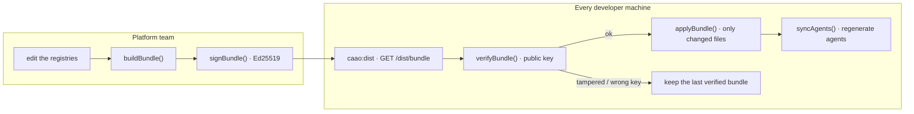
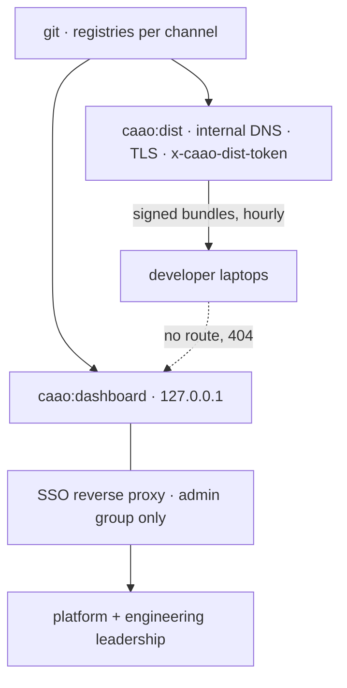

# 7. Distributing the configuration to every developer

Two questions drive this chapter:

1. **How do a hundred developers stay permanently up to date** with a configuration that the
   platform team keeps changing?
2. **How does the console stay off their machines**, given that it exposes company-wide spend,
   repository names and individual developer identities?

The answer to both is the same design decision: **the configuration and the console are two
different servers with two different audiences, and neither knows anything about the other.**

---

## 1. What is actually distributed

| Distributed | Not distributed |
| --- | --- |
| `capabilities.yaml` — what work exists | Run files (`state/runs/*.json`) — private to the machine that produced them |
| `providers.yaml` — which model and which price | Agent definitions (`agent/*.md`) — **regenerated locally** from the bundle |
| `policies.yaml` — which capability fires when | API keys — the catalog stores `{env:GITHUB_TOKEN}`, never the value |
| `workflows.yaml` — parallel topology and budgets | The dashboard itself |
| `catalog.yaml` — company MCP servers and skills | `distribution.json` — bootstrap, see §3 |
| `prompts/execution-manager.md` — the orchestrator's instructions | |

Agent files are deliberately excluded. Shipping generated artefacts alongside their source
invites the two to disagree; instead every machine runs `syncAgents()` immediately after applying
a bundle, so the agents are always a pure function of the registries that produced them.

Nothing else may be in a bundle. `verifyBundle` rejects any file name outside `MANAGED_FILES`,
which is what stops a compromised server from shipping `../../.bashrc`.

---

## 2. The bundle: content-addressed and signed



**Versions are content hashes, not numbers.** `bundleVersion()` is `sha256` over a canonical,
key-sorted `{filename: content}` map, truncated to 16 hex characters. Identical bytes always
produce an identical version; one changed byte anywhere produces a new one. Nobody has to
remember to bump anything, and two servers serving the same files are provably serving the
same configuration.

**Signatures cover content, not clocks.** The signed payload is
`schema:channel:version:canonical(files)`. `generatedAt` and `notes` are excluded on purpose, so
re-publishing the same configuration does not invalidate a signature, while changing a single
character does.

**Why sign at all.** These files decide which model runs, with which tools, under which prompt.
An unsigned channel would be remote code execution by proxy: whoever controls the config server
controls what every agent in the company is told to do. The public key is not a secret and is
shipped with the bootstrap file; the private key never leaves the distribution server.

```powershell
npm run caao:keygen              # writes caao-keys/caao-signing.key + .pub
$env:CAAO_SIGNING_KEY = "C:\caao-keys\caao-signing.key"
$env:CAAO_DIST_TOKEN  = "…"      # optional shared secret for developer machines
npm run caao:dist                # serves /dist/* on 20129
```

---

## 3. The bootstrap file

A machine must know *where to fetch from* before it has any configuration, so exactly one file
is shipped by hand and is never part of a bundle: `.opencode/distribution.json`.

```json
{
  "url": "https://caao.internal.acme.dev",
  "channel": "stable",
  "publicKey": "caao-signing.pub",
  "autoUpdate": true,
  "checkIntervalMinutes": 60,
  "timeoutMs": 2500
}
```

Every field is overridable by environment variable, so CI and canary machines can be redirected
without editing anything:

| Variable | Overrides |
| --- | --- |
| `CAAO_CONFIG_URL` | `url` — also what *enables* distribution at all |
| `CAAO_CHANNEL` | `channel` |
| `CAAO_CONFIG_KEY` | `publicKey` (inline PEM or a path) |
| `CAAO_CONFIG_TOKEN` | `token`, sent as `x-caao-dist-token` |
| `CAAO_AUTO_UPDATE` | `autoUpdate` |
| `CAAO_CHECK_INTERVAL` | `checkIntervalMinutes` |
| `CAAO_CONFIG_TIMEOUT` | `timeoutMs` |
| `CAAO_NO_UPDATE` | disables the startup check entirely, whatever the file says |

Ship it once, by whichever mechanism you already trust:

* an internal npm package (`@acme/opencode-config`) with a `postinstall` that copies it, or
* dotfiles / a bootstrap script, or
* MDM / Intune for laptops you manage.

That is the only thing you ever have to distribute manually. Everything after it updates itself.

---

## 4. How a developer stays up to date

`updateOnStartup()` runs inside the plugin's `config()` hook, before anything reads a registry:

1. **Throttled.** If the last check was less than `checkIntervalMinutes` ago, it returns
   immediately. Opening ten terminals costs zero round trips.
2. **Bounded.** The fetch is wrapped in an `AbortController` with `timeoutMs` (2.5 s default).
   A slow network delays nobody.
3. **Verified.** A bad signature, an unknown key, an unmanaged file name or a version that does
   not match its content all mean *nothing is written* and the machine keeps the last verified
   bundle.
4. **Minimal.** `applyBundle` writes only files whose content actually differs, via a temp file
   and an atomic rename. Files the developer owns are untouched.
5. **Consistent.** After writing, the config cache is cleared and the agents are regenerated. If
   the new configuration fails validation the status is `invalid` and it says so loudly, rather
   than silently running yesterday's agents against today's registries.

**An outage is never fatal.** `update()` returns a status instead of throwing:

| Status | Meaning | Effect on the developer |
| --- | --- | --- |
| `updated` | new bundle applied | agents regenerated, one log line |
| `current` | already on this version | none |
| `throttled` | checked recently | none |
| `disabled` | no URL, or auto-update off | none |
| `unreachable` | server down or slow | keeps working on the last verified bundle |
| `rejected` | signature/shape failed | **nothing written**, loud warning |
| `invalid` | applied but does not validate | loud error |

Manual control, for when someone wants it now:

```powershell
npm run caao:update            # fetch, verify, apply, regenerate
npm run caao:update -- --check # is there a newer bundle? (exit 2 = yes)
npm run caao:update -- --force # re-apply the current version
```

Any developer can also ask, mid-session, what they are running:

```
caao_registry { "kind": "distribution" }
→ { version, channel, appliedAt, source, trusted, autoUpdate, lastStartupCheck }
```

---

## 5. Channels and staged rollout

The dist server maps a channel name to a directory:

```powershell
$env:CAAO_DIST_CHANNELS = '{"stable":"/srv/caao","canary":"/srv/caao-canary"}'
```

A change lands in `canary` first. A handful of machines run with `CAAO_CHANNEL=canary`; the rest
never see it. When it proves out, the same files are promoted into `/srv/caao` and the whole
company picks them up at their next startup check.

**Rollback is a `git checkout` on the server.** Because versions are content hashes, reverting the
files reverts the version to the exact hash the company was on before — no separate version
ledger to keep in sync, no ambiguity about what "the previous release" means.

The console's **Distribution** view (`GET /api/distribution`) shows every channel, its current
version, the files it contains and whether the server holds a signing key.

---

## 6. Why developers cannot open the console

The console reports what every developer in the company asked for, what it cost and which
repository it touched. That is management information and, in several jurisdictions, personal
data. It is not a developer tool.

The same executable therefore runs in one of three roles:

| Role | Command | Serves | Reachable by |
| --- | --- | --- | --- |
| `admin` | `npm run caao:dashboard` | the console and `/api/*` | admins only |
| `dist` | `npm run caao:dist` | `/dist/*` only | every developer machine |
| `both` | `--both` | both | single-machine demos only |

Layered defences, in the order an attacker meets them:

1. **Role separation with 404 masking.** A `dist` server answers **404** — not 403 — for `/`,
   `/app.js` and every `/api/*` path. A developer's machine cannot even learn that a console
   exists behind that hostname. A 403 would confirm it.
2. **No token, no console.** The admin role *refuses to start* without `CAAO_ADMIN_TOKEN`:

   ```
   CAAO: the admin console refuses to start without CAAO_ADMIN_TOKEN.
   ```

   There is no "open by default" mode to forget to close. If the variable is somehow empty at
   runtime, `isAdmin()` returns `false` for everyone rather than `true`.
3. **Loopback by default.** It binds `127.0.0.1`. Binding elsewhere prints a warning telling you
   to put an authenticating proxy in front of it.
4. **Session, not a token in the URL.** `POST /api/session` exchanges the token for an
   `HttpOnly; SameSite=Strict; Path=/; Max-Age=43200` cookie — `Secure` too when not on loopback.
   JavaScript cannot read it, so an injected script cannot exfiltrate it, and it does not travel
   cross-site.
5. **Constant-time comparison.** `timingSafeEqual` on length-checked buffers, so the token cannot
   be recovered a byte at a time.
6. **Login rate limiting.** 10 attempts per 5 minutes per remote address.
7. **Double submit on mutations.** Toggling a catalog entry requires the `x-caao-token` header
   *as well as* the session. A cookie alone cannot change state, which closes CSRF even if
   `SameSite` were bypassed.
8. **The static shell carries no data.** `index.html`, `app.js` and `styles.css` are served
   without authentication because they contain nothing; every figure they display comes from an
   authenticated `/api/*` call. A 401 sends the UI back to the sign-in card.

What a developer *can* reach is `/dist/*`, optionally behind `x-caao-dist-token`: three read-only
endpoints that never open a run file.

| Endpoint | Returns |
| --- | --- |
| `GET /dist/version?channel=` | `{channel, version, generatedAt}` — a cheap freshness probe |
| `GET /dist/bundle?channel=` | `{bundle, signature}` — 503 if the server has no signing key |
| `GET /dist/manifest?repo=&team=` | the MCP servers and skills this machine should have |

---

## 7. Distributing skills and MCP servers

`catalog.yaml` travels inside the bundle, so publishing a new company skill is:

1. add the entry to `catalog.yaml`, with a `scope` of `all`, specific `repos` or specific `teams`;
2. commit it to the channel directory.

Every machine picks it up at its next startup check and computes its own manifest — a developer on
`acme/billing-service` receives `postgres-readonly` and `billing-domain`, a developer on the
website does not. Retiring one is `enabled: false`, which removes it everywhere within an hour
without asking anyone to do anything. Admins can flip that switch from the console's MCP & skills
view.

After signature verification, developer-side catalog sync removes previously managed MCP entries, adds the currently enabled entries for that repository/team, and preserves locally owned MCP configuration. Inline signed skill content is materialised only beneath `.opencode/`; unsafe paths are rejected. Disabling a context tool therefore removes it on the next update without deleting unrelated developer configuration.

Secrets never travel. A catalog entry declares `{env:GITHUB_TOKEN}`; the manifest lists
`requiredEnv` so a machine can tell the developer what to set, and nothing more.

---

## 8. Recommended production topology



* One `dist` server, reachable company-wide, TLS terminated, holding the private signing key.
* One `admin` host, on loopback, published only through your SSO proxy to an admin group. The
  `CAAO_ADMIN_TOKEN` is then a second factor behind SSO, not the only one.
* Registries in git, one branch or directory per channel. Every configuration change is a pull
  request, every rollout is a merge, every rollback is a revert.

---

## 9. What is tested

`npm run test:dashboard` and the `centralised configuration distribution` unit suite together
assert, against real servers and real files:

* a bundle carries exactly the managed files and no run data;
* identical bytes give identical versions; one edited byte does not;
* content is bound to its filename, and key order is irrelevant;
* tampered, unsigned, wrongly-keyed and version-laundered bundles are all refused;
* a bundle naming an unmanaged path is refused before anything is written;
* re-publishing with a new timestamp keeps the signature valid;
* apply is idempotent, corrects local drift and leaves the developer's own files alone;
* every console endpoint refuses anonymous and wrong-token callers, leaking no data in the error;
* the session cookie is `HttpOnly` and `SameSite=Strict`;
* a cookie alone cannot mutate state;
* a `dist` server returns **404** for `/`, `/app.js` and every `/api/*` path;
* `/dist/*` enforces its token and 404s an unknown channel;
* a bundle served over HTTP verifies and applies on the other side.
