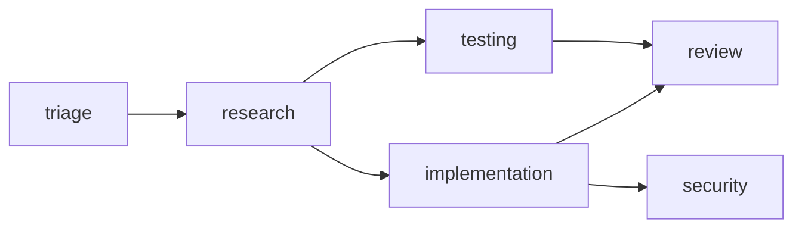

# 08 — Mappa dei file

> Documento in italiano. Descrive **cosa fa ogni file** del progetto e, alla fine, mostra **un
> esempio concreto** di una richiesta che attraversa l'intero sistema, dal prompt alla dashboard.

CAAO è un orchestratore per [opencode](https://opencode.ai). Riceve una richiesta in linguaggio
naturale, la classifica, decide **quali** competenze servono, costruisce un grafo di task, assegna a
ciascuno il modello giusto e traccia costi e token reali. Tutta la logica di orchestrazione è
**deterministica**: nessuna chiamata a un LLM, quindi interamente testabile.

Il principio che spiega quasi ogni scelta di questo codice:

> **Una capability non nomina mai un modello.** Dice *cosa* serve fare. Chi lo esegue è deciso
> altrove, da un file separato che si può cambiare senza toccare nulla del resto.

---

## 1. Radice del progetto

| File | Cosa fa |
| --- | --- |
| `package.json` | Definisce gli script operativi: `test`, `test:e2e`, `test:dashboard`, `test:all`, `caao:sync`, `caao:catalog`, `caao:doctor`, `caao:update`, `caao:keygen`, `caao:dashboard`, `caao:dist`. Non ci sono dipendenze di runtime: il progetto usa solo Node. |
| `README.md` | Panoramica, quick start, indice dei documenti. |
| `caao-keys/` | Chiavi di firma della distribuzione. La **pubblica** (`caao-signing.pub`) può essere condivisa; la privata non deve mai entrare in un repository. |
| `dashboard/` | La console web di amministrazione. Sta **fuori** da `.opencode/` di proposito: alla macchina di uno sviluppatore serve solo la configurazione, non il pannello che mostra la spesa di tutta l'azienda. |
| `docs/` | Questa documentazione. |
| `tests/` | Test unitari e di integrazione. |

---

## 2. `.opencode/` — i registri dichiarativi

Sono il **cuore configurabile** del sistema: cambiare il comportamento significa cambiare uno di
questi YAML, non il codice.

| File | Domanda a cui risponde | Contenuto |
| --- | --- | --- |
| `capabilities.yaml` | **COSA** sa fare il sistema | 15 capability (triage, research, planning, implementation, testing, review, security, …). Ogni capability ha fase, prompt, criteri di output. **Non nomina mai un modello.** |
| `providers.yaml` | **CHI** esegue una capability | Pool di modelli (`opus-5`, `kimi-code`), i loro `traits` astratti (reasoning, quality, speed, cost 1..5), le strategie di scelta, i binding capability → pool, le regole di escalation e il **listino prezzi reale** (`pricing.*_per_mtok`) e i budget. |
| `policies.yaml` | **QUANDO** una capability serve | Regole di classificazione (keyword, glob, dominio), soglie di confidenza, policy base/augment/post. |
| `workflows.yaml` | **COME** si esegue un insieme di capability | Strategie di esecuzione (sequenziale, ondate parallele), retry, gate bloccanti, regole di merge. |
| `catalog.yaml` | **COSA RICEVE OGNI SVILUPPATORE** | MCP aziendali, skill e context tool (caveman, headroom, graphify), con `scope` per repository o team, e la dichiarazione di **come ogni tool riporta i token risparmiati**. |
| `distribution.json` | **DA DOVE ARRIVA LA CONFIGURAZIONE** | L'unico file consegnato a mano: URL del server di distribuzione, canale, chiave pubblica. Tutto il resto si aggiorna da solo. |
| `opencode.json` | Configurazione nativa di opencode | Provider, modelli, e il blocco `mcp` **generato** da `npm run caao:catalog`. |
| `package.json` | Dipendenze del plugin (`@opencode-ai/plugin`). |
| `agent/*.md` | **File generati.** Una definizione di agente per ogni capability × pool. Modificarli a mano è inutile: il prossimo `caao:sync` li riscrive e un test fallisce. |
| `prompts/execution-manager.md` | La dottrina dell'Execution Manager: come deve usare i tool `caao_*`, e il divieto di scegliere modelli da solo. |
| `state/runs/` | Un file JSON per ogni run: grafo, risultati, usage osservato, costi, risparmi. |

### Due numeri di costo, volutamente separati

| Dove | Cosa rappresenta | A cosa serve |
| --- | --- | --- |
| `traits.cost` (1..5) | Costo **astratto** | **Routing.** Serve a ordinare i candidati. Non cambia se domani il fornitore raddoppia le tariffe. |
| `pricing.*_per_mtok` (USD) | Costo **reale** | **Fatturazione.** Serve solo a dire quanto è costato. Non entra mai nella scelta del modello. |

Mescolarli renderebbe il routing instabile a ogni variazione di listino.

---

## 3. `.opencode/caao/` — il motore

Codice puro, senza LLM, testato unitariamente. Ogni file ha una responsabilità sola.

### 3.1 Fondamenta

| File | Cosa fa | Perché esiste |
| --- | --- | --- |
| `config.js` | Carica e valida i cinque YAML, espone `CAAO_HOME`, `loadConfig()`, `allCapabilities()`, `capability()`. Tiene una cache. | Un errore di configurazione deve fallire subito e in modo leggibile, non a metà di un run. |
| `state.js` | Legge e scrive i file di run su disco. Espone `withRunLock()`, `loadRun()`, `saveRun()`, `listRuns()`, `runPath()`. | Più worker in parallelo scrivono sullo stesso run: senza lock il grafo si corrompe. |
| `match.js` | Confronti puri: `matchesKeyword`, `matchesGlob`, `evaluate`. | Isolare il pattern matching lo rende testabile senza costruire un run. |

### 3.2 Dalla frase al piano

| File | Cosa fa |
| --- | --- |
| `context.js` | Legge il repository: slug `owner/name` da qualunque forma di remote (`repoSlug`), branch, file modificati, autore (`repoSignals`). Serve ad attribuire la spesa. |
| `classify.js` | Trasforma la richiesta in **segnali**: intento, complessità, domini toccati, evidenze. È il primo passo e non usa un LLM. |
| `policy.js` | Da segnali a **capability**: `resolveCapabilities()` decide cosa serve e lascia una `trace` del perché; `selectStrategy()` sceglie la strategia di esecuzione; `evaluatePost()` applica le policy post-esecuzione (es. una review obbligatoria se la confidenza è bassa). |
| `provider.js` | Da capability a **modello**: applica strategia, `candidates`, override ed escalation. `resolveProvider()` restituisce pool, modello, tier e nome agente. `providerTable()` è la vista completa per la dashboard. |
| `dag.js` | Costruisce e manipola il grafo: `buildGraph`, `readyNodes`, `waves` (le ondate parallele), `expandNode`, `resetDownstream`, `isComplete`, `toMermaid`. |

### 3.3 Esecuzione e contabilità

| File | Cosa fa |
| --- | --- |
| `engine.js` | Il coordinatore. `plan()` crea il run, `next()` distribuisce i task pronti, `record()` registra un risultato, `expand()` aggiunge sottotask, `merge()` chiude il run, `report()` produce il consuntivo. Contiene anche `ingestUsage()` e `recordContextSavings()`, cioè la contabilità di ciò che è stato realmente consumato. |
| `usage.js` | Traduce gli eventi di opencode in **osservazioni fatturabili** e risponde alla domanda difficile: *quale task ha prodotto questo messaggio?* (`observationFrom`, `attributionTarget`, `addUsage`, `subtractUsage`, `poolForModel`). |
| `savings.js` | Estrae dai tool di compressione i **token risparmiati che il tool stesso dichiara** (`extractSavings`, `toolBelongsTo`, `ownerOf`). Non stima mai: una chiamata che non pubblica numeri viene contata come "non misurata". |
| `pricing.js` | Da token a denaro: `costOf`, `usageOf`, `budgets`, `budgetState`, `priceTable`, `currency`, `sum`. |
| `analytics.js` | Aggrega i run per la dashboard: `summarize`, `overview`, `byModel`, `byCapability`, `byContextTool`, `daily`, `repositories`. |
| `rationale.js` | Ricostruisce la catena causale "perché questo DAG": `explain()` e `counterfactuals()` (cosa avrebbe cambiato il piano). |

#### Perché `usage.js` esiste

Un worker **non può** riportare i propri token: non li vede. Chiederglielo produceva zeri, e una
dashboard che fatturava ogni run 0,00 $. opencode invece li conosce esattamente: ogni messaggio
assistente porta con sé il consumo reale. Il plugin intercetta quegli eventi e li passa al motore.

L'attribuzione segue tre regole, in ordine:

1. **Nome dell'agente.** `caao-implementation--opus-5` è stato lanciato per una capability precisa.
2. **Worker identici in parallelo.** Nessun segnale può distinguerli: prende il messaggio quello
   meno fatturato finora. Sull'ondata il totale è esatto, sul singolo nodo è una ripartizione equa.
3. **Messaggio in ritardo.** Un messaggio finale può arrivare dopo che il task è stato registrato:
   entro due minuti appartiene ancora a quel task.

Se l'agente è l'orchestratore stesso (`caao`, `build`, `plan`, …) il consumo **non** viene attribuito
a nessun task: finisce nel bucket `orchestrator` del run. Nascondere quella quota farebbe sembrare
ogni run più economico di quanto è.

### 3.4 Catalogo aziendale e diagnostica

| File | Cosa fa |
| --- | --- |
| `catalog.js` | Legge `catalog.yaml`, annota gli elementi (`catalog()`), calcola cosa spetta a una macchina in base a repository e team (`manifestFor`, `matchesScope`), genera il blocco `mcp` (`mcpBlock`) e valida il file (`validateCatalog`). |
| `catalog-sync.js` | Scrive fisicamente il manifesto sulla macchina: blocco `mcp` dentro `opencode.json`, file delle skill, e rimozione di ciò che non spetta più. |
| `catalog.mjs` | CLI: `npm run caao:catalog`. Materializza il catalogo e stampa subito la diagnostica. |
| `doctor.js` | Verifica **offline** che ogni MCP e context tool dichiarato sia davvero utilizzabile: binario presente nel PATH, URL in HTTPS, variabili d'ambiente impostate, voce presente in `opencode.json`. Non avvia nulla. |
| `doctor.mjs` | CLI: `npm run caao:doctor`. Esce con codice diverso da zero se qualcosa è rotto, così una pipeline può bloccarsi. |
| `agents.js` | Genera i file in `agent/` da capability e provider (`renderAgents`), e rileva la deriva fra YAML e file generati (`detectDrift`). Definisce `ORCHESTRATION_TOOLS`, i tool riservati all'Execution Manager. |
| `sync.mjs` | CLI: `npm run caao:sync`. |

**"Dichiarato" e "funzionante" sono cose diverse.** Prima di `doctor.js` il catalogo mostrava solo la
prima: è così che cinque server MCP potevano risultare configurati mentre nessuno di essi girava.

### 3.5 Distribuzione e console

| File | Cosa fa |
| --- | --- |
| `distribution.js` | Bundle firmati: `buildBundle`, `signBundle`, `verifyBundle`, `applyBundle`, `bundleVersion`, `MANAGED_FILES`. Un bundle che tenta di scrivere fuori dall'elenco gestito viene rifiutato. |
| `update.js` / `update.mjs` | Aggiornamento all'avvio e da riga di comando (`npm run caao:update`, con `--check` e `--force`). |
| `keygen.mjs` | Genera la coppia di chiavi di firma (`npm run caao:keygen`). |
| `server.mjs` | Due server HTTP con ruoli separati: `admin` (la console: spesa, run, repository, identità — autenticato, in loopback) e `dist` (solo bundle firmati e manifesto per macchina). Il server `dist` non si limita a rifiutare le rotte della console: risponde **404**, così una macchina di sviluppo non può nemmeno scoprire che una console esiste. |
| `seed-demo.mjs` | Genera run finti per vedere la dashboard popolata. |

---

## 4. `.opencode/plugin/caao.js` — l'adattatore

È l'unico punto di contatto con opencode. Fa quattro cose:

1. **Espone il motore come tool** `caao_context`, `caao_triage`, `caao_plan`, `caao_next`,
   `caao_expand`, `caao_record`, `caao_merge`, `caao_catalog`, `caao_doctor`, `caao_status`,
   `caao_report`, `caao_registry`.
2. **Misura il consumo reale**: l'hook `event` intercetta ogni messaggio assistente completato e lo
   passa a `ingestUsage()`.
3. **Misura i risparmi**: l'hook `tool.execute.after` passa l'output dei context tool a
   `recordContextSavings()`.
4. **Avvisa all'avvio** se un agente è stale o se un tool dichiarato non può partire.

All'avvio il plugin **non riscrive** `opencode.json`: modificare la configurazione del processo che
la sta già leggendo sarebbe sia invisibile sia troppo tardi. Segnala e basta; a scrivere è
`npm run caao:catalog`.

---

## 5. `dashboard/` — la console

| File | Cosa fa |
| --- | --- |
| `index.html` | Struttura della pagina, niente framework. |
| `app.js` | Tutte le viste: Overview, Runs, Costs, Repos, Models, Catalog, più il drawer con DAG (SVG generato a mano), task, e razionale. Ogni interpolazione passa da `esc()`. |
| `styles.css` | Tema scuro, nessun build step. |

Cosa mostra riguardo a token e costi:

- **Overview** — token di input e output, quota letta da cache, overhead di orchestrazione, token risparmiati.
- **Costs** — input/output per modello e per capability, task vs orchestrazione, e la sezione
  **"Context tools — tokens saved"** con `Saved`, `Cut` (percentuale tagliata), `Cost avoided` e
  quante chiamate non hanno dichiarato nulla.
- **Catalog** — per ogni voce, se su questa macchina è davvero **utilizzabile**, e in caso contrario
  il motivo e il comando di installazione.
- **Drawer di un run** — input/output per singolo task, overhead di orchestrazione, risparmi del run.

---

## 6. `tests/`

| File | Cosa verifica |
| --- | --- |
| `caao.test.mjs` | 163 test unitari: configurazione, classificazione, policy, provider, DAG, motore, prezzi, **contabilità osservata**, **risparmi dei context tool**, **diagnostica**, analytics, razionale, catalogo, distribuzione. |
| `integration/e2e.mjs` | Ripunta `providers.yaml` su un provider finto, rigenera gli agenti e lancia un vero `opencode run`. Dimostra due cose insieme: il ciclo funziona *dentro* opencode, e cambiare fornitore è la modifica di un solo file. |
| `integration/mock-provider.mjs` | Provider OpenAI-compatibile scriptato. Ritarda le risposte dei worker apposta, così il picco di worker in volo dimostra che opencode li esegue davvero in parallelo. |
| `integration/dashboard.mjs` | Le API della console: autenticazione, isolamento della superficie `dist`, path traversal, round trip di un bundle firmato. |
| `integration/examples.mjs` | Mostra come una modifica agli YAML cambia il piano su richieste reali. |
| `fixtures/broken/*` | Registri volutamente invalidi, per verificare che la validazione fallisca in modo chiaro. |

---

## 7. Esempio concreto: una richiesta dall'inizio alla fine

Richiesta:

> *"Fix the failing unit tests in the billing module"*

### Passo 0 — preparazione (una volta sola)

```powershell
cd .opencode; npm install; cd ..
npm run caao:sync       # genera 32 file in .opencode/agent/
npm run caao:catalog    # scrive il blocco mcp in opencode.json
npm run caao:doctor     # i tool dichiarati partono davvero?
```

`caao:doctor` stampa qualcosa del genere:

```
CAAO diagnostics — 3/5 usable, 2 not applicable here

  ✗   graphify  (context_tool, local)
        command: python -m graphify.serve graphify-out/graph.json
        · command "python" is not on PATH
        install: uv tool install "graphifyy[mcp]"
```

Questa è la risposta alla domanda "graphify funziona?": prima non esisteva alcun modo di saperlo se
non accorgersi che il tool non compariva mai.

### Passo 1 — la richiesta

```powershell
opencode run --agent caao --auto "Fix the failing unit tests in the billing module"
```

### Passo 2 — classificazione e triage

L'Execution Manager chiama `caao_triage`. `classify.js` produce i segnali:

```json
{ "intent": "fix", "complexity": "moderate", "domains": ["testing", "billing"] }
```

### Passo 3 — il piano

`caao_plan` → `policy.js` sceglie le capability, `provider.js` assegna un pool a ciascuna,
`dag.js` costruisce il grafo e lo divide in ondate:



Ondata 1: `triage`. Ondata 2: `research`. Ondata 3: `implementation`, `testing`, `security` **in
parallelo**. Ondata 4: `review`.

Nessuna capability ha nominato un modello: `implementation` è finita su `opus-5` perché
`providers.yaml` lega quella capability a un profilo che ordina i pool per reasoning.

### Passo 4 — esecuzione

`caao_next` restituisce i task pronti con l'agente da usare. L'Execution Manager li lancia **tutti
nello stesso turno** con il tool `task`. Ogni worker riceve un brief autonomo e non sa nulla di
costi, budget o modelli.

Mentre girano, opencode emette `message.updated`. Il plugin li intercetta:

```
messaggio da caao-implementation--opus-5  →  ingestUsage()
   → attribuito al nodo "implementation"
   → +12.400 token input, +3.100 output, costo dal listino aziendale

messaggio da caao (l'Execution Manager stesso)
   → nessun task in volo che gli appartenga
   → finisce nel bucket "orchestrator" del run
```

Se durante il lavoro un worker chiama `headroom_compress`, l'hook `tool.execute.after` legge i numeri
che il tool ha pubblicato e li registra:

```
headroom_compress  →  original_tokens 40.000, compressed_tokens 6.000
                   →  34.000 token risparmiati, valorizzati al prezzo di input del pool
```

Se lo stesso tool non pubblica alcun numero, la chiamata viene contata come **non misurata** e resa
visibile come tale. Non viene mai inventata una percentuale.

### Passo 5 — risultati e chiusura

Ogni worker termina e l'Execution Manager chiama `caao_record`. Se la confidenza è sotto la soglia,
`policies.yaml` può imporre un retry con escalation a un modello più pesante — e l'escalation resta
tracciata. Quando il grafo è completo, `caao_merge` chiude il run e `caao_report` produce il
consuntivo.

### Passo 6 — la dashboard

```powershell
$env:CAAO_ADMIN_TOKEN = "…"
npm run caao:dashboard      # http://127.0.0.1:20129
```

Il run compare con:

| Voce | Valore |
| --- | --- |
| Input / Output token | 138.000 / 28.000 |
| Costo task | il consumo dei worker, per nodo |
| Overhead di orchestrazione | quanto è costato pianificare e distribuire |
| Token risparmiati | 34.000, con il costo evitato |
| Modelli usati | `opus-5` per implementation, `kimi-code` per review |

E soprattutto: **il costo non è più zero**, perché non dipende più dalla buona volontà di un worker
nel dichiarare numeri che non può vedere.

---

## 8. Riepilogo dei comandi

| Comando | Cosa fa |
| --- | --- |
| `npm run caao:sync` | Rigenera le definizioni degli agenti dagli YAML. |
| `npm run caao:catalog` | Scrive il catalogo aziendale in `opencode.json` e stampa la diagnostica. |
| `npm run caao:doctor` | Verifica che ogni MCP e context tool dichiarato sia utilizzabile. Esce ≠ 0 se no. |
| `npm run caao:update` | Scarica, verifica e applica un bundle firmato di configurazione. |
| `npm run caao:keygen` | Genera le chiavi di firma. |
| `npm run caao:dashboard` | Avvia la console di amministrazione (richiede `CAAO_ADMIN_TOKEN`). |
| `npm run caao:dist` | Avvia il server di distribuzione per gli sviluppatori. |
| `npm test` | 163 test unitari, senza LLM. |
| `npm run test:e2e` | Ciclo completo dentro opencode contro un provider finto. |
| `npm run test:dashboard` | API della console e isolamento della superficie di distribuzione. |
| `npm run test:all` | Tutti e tre. |
